# كتاب تعريفي ودراسة أكاديمية لمشروع التخرج

## نظام بصيرة (Basera)
### منصة تعليمية صوتية للمكفوفين  
#### تحليل وتصميم وتنفيذ نظام معلومات تعليمي قائم على التفاعل الصوتي الكامل

> «التعليم حقّ للجميع؛ والوصول إليه يجب أن يكون ممكناً بالصوت كما هو ممكن بالبصر.»

---

## صفحة الغلاف الأكاديمية

| البند | البيان |
| ----- | ------ |
| **الجامعة / الكلية / القسم** | …………………… |
| **عنوان المشروع** | بصيرة: منصة تعليمية صوتية للمكفوفين |
| **نوع العمل** | مشروع تخرج — نظام برمجي تطبيقي مع دراسة تحليل وتصميم |
| **اسم الطالب / الطلبة** | …………………… |
| **الرقم الجامعي** | …………………… |
| **اسم الدكتور المشرف** | …………………… |
| **العام الجامعي** | 2025 / 2026 |
| **إصدار الوثيقة** | 4.0 — نسخة التسليم (مطابقة للكود المنشور على basera.mobishop.online) |

هذه الوثيقة موجّهة أولاً إلى **الدكتور المشرف ولجنة المناقشة** كمرجع للتوجيه والمتابعة والتقويم: المشكلة، المنهج، المتطلبات، التصميم، التنفيذ، الاختبار، والحدود. وقد رُوجعت في هذه النسخة بحيث تعكس **الحالة الفعلية للكود المُنفَّذ** لا التصميم المقترح فقط.

---

### بطاقة المشروع

| البند | التفاصيل |
| ----- | -------- |
| **اسم المشروع** | بصيرة (Basera) |
| **طبيعة الوثيقة** | كتاب تعريفي + دراسة أكاديمية لمشروع التخرج |
| **نوع المشروع** | تطبيق جوال مع خادم خلفي (Client–Server) |
| **التقنيات** | Flutter (واجهة أمامية) + Django 4.2 / Django REST Framework (خادم خلفي) |
| **قاعدة البيانات** | SQLite للتطوير — MySQL على الاستضافة |
| **النشر** | خادم منشور على `https://basera.mobishop.online` + تطبيق Android (APK) |
| **الفئة المستهدفة** | المكفوفون كلياً من عمر 14 سنة فما فوق |
| **المراحل التعليمية** | من الصف التاسع حتى التعليم الجامعي |
| **لغة الواجهة** | العربية (RTL) مع دعم قارئات الشاشة |
| **نمط التفاعل** | Audio-first — الصوت قناة الإنجاز الأساسية |
| **الجهة المجتمعية الداعمة** | جمعية «نبض» لتعليم المكفوفين (واجهة تعريفية مدمجة في الخادم) |

---

### إهداء

إلى كل طالبٍ لم يمنعه فقد البصر من طلب العلم، وإلى كل متطوعٍ يحوّل صوته ووقته إلى جسر معرفة، وإلى كل معلّمٍ يؤمن أن التقنية أداة إنصاف لا ترفاً، وإلى الدكتور المشرف الذي تُعرض عليه هذه الصفحات طلباً للتوجيه والتقويم.

---

### شكر وتقدير

يتقدّم معدّ هذه الدراسة بالشكر إلى الدكتور المشرف على ما سيقدّمه من ملاحظات منهجية وعلمية، وإلى كل من أسهم في بلورة مشروع بصيرة. كما يُشكر مجتمع البرمجيات المفتوحة الذي أتاح أدوات Flutter وDjango وWhisper وغيرها.

---

### كلمة إلى الدكتور المشرف

تجمع هذه الوثيقة ثلاثة مستويات يحتاجها المشرف عند المتابعة:

1. **المستوى المفاهيمي:** المشكلة، الفئة المستهدفة، التميز، والأثر.
2. **المستوى الهندسي:** المتطلبات، الكيانات، الواجهات، والقرارات المعمارية.
3. **المستوى التنفيذي والنقدي:** ما بُني في الكود، القيود، الازدواجيات، والمخاطر.

---

### كلمة افتتاحية

هذا الكتاب ليس مجرّد تقرير تقني يُسلَّم في نهاية فصل دراسي، بل محاولة لسرد مشروع **بصيرة** من الفكرة إلى المخططات، ومن المشكلة الإنسانية إلى القرارات الهندسية. نهدف أن يخرج القارئ — ولا سيما المشرف — بصورة كاملة: لماذا وُجد المشروع؟ لمن؟ كيف يُفكَّر؟ كيف يُصمَّم؟ وكيف يُبنى ويُختبر؟

بصيرة وُلدت من ملاحظة يومية في التعليم الرقمي: معظم ما يُسمّى «إتاحة» للمكفوفين هو إلحاق قارئ شاشة بتطبيق صُمم للمبصرين. أما الإنصاف الحقيقي فيبدأ عندما تُصاغ رحلة التعلّم حول **الصوت والتنظيم والمنهج**، لا حول إنقاذ واجهة بصرية بعد اكتمالها.

---

### الملخص (بالعربية)

يعالج مشروع **بصيرة** مشكلة ضعف الوصول التعليمي الرقمي المنظم للطلاب المكفوفين في السياق العربي، حيث تُبنى أغلب المنصات التعليمية على فرضية الإبصار ثم تُلحق بها طبقة «قارئ شاشة» لا تكفي لبناء تجربة تعلّم متكاملة. تقترح الدراسة وتُنفّذ منصة **صوتية أولاً (Audio-first)** مكوّنة من تطبيق جوال بـ Flutter وخادم خلفي بـ Django REST Framework، تقدّم: مكتبة هرمية للمحتوى (صف ← مادة ← درس ← أقسام)، ثلاثة أوضاع لإدخال الدرس (نص مباشر، ملف صوتي بشري، PDF يُحوَّل آلياً إلى نص ثم صوت)، استماعاً بمسارين (تسجيل بشري أو قراءة آلية TTS) مع إيقاف ومتابعة من نفس الموضع، أوامر صوتية للتنقل، تتبعاً لتقدّم الطالب، اختبارات مرتبطة بالدروس مع تصحيح آلي للأسئلة الموضوعية ومراجعة بشرية للمفتوحة، ونظاماً للمتطوعين يضمن جودة التفريغ. اتُّبع منهج هندسة برمجيات تكراري من تحليل المتطلبات (15 متطلباً وظيفياً و8 غير وظيفية) إلى النمذجة (ERD، UML) والتنفيذ والنشر على استضافة حقيقية، ثم الاختبار الآلي (15 اختبار API و5 اختبارات Flutter ناجحة) واختبار الجهاز. تخلص الدراسة إلى أن النموذج قابل للتشغيل والتوسّع، وتوثّق بشفافية قيوده: دقة التعرف الصوتي العربي، شحّ المحتوى عند الإطلاق، وعدم اكتمال العمل دون اتصال.

**الكلمات المفتاحية:** إمكانية الوصول، التعليم الصوتي، المكفوفون، تحويل النص إلى كلام، Flutter، Django REST، مشروع تخرج.

### Abstract (English)

**Basera** addresses the limited availability of structured, accessible digital learning for totally blind Arabic-speaking students, for whom most platforms are visual-first with screen-reader support added as an afterthought. This study designs and implements an **audio-first** platform consisting of a Flutter mobile application and a Django REST Framework back end. The system provides a hierarchical content library (grade → subject → lesson → sections), three lesson-authoring modes (plain text, human audio, or PDF converted automatically to text and then speech), dual playback (human recording or TTS) with pause/resume, voice navigation commands, per-student progress tracking, lesson-linked quizzes with automatic grading of objective questions and human review of open ones, and a volunteer workflow for transcript quality assurance. An iterative software-engineering methodology was followed from requirements analysis (15 functional and 8 non-functional requirements) through ERD/UML modelling, implementation, deployment to a live host, and verification (15 passing API tests and 5 passing Flutter tests plus device testing). The study concludes that the prototype is operational and extensible, while transparently documenting its limits: Arabic speech-recognition accuracy, initial content scarcity, and incomplete offline support.

**Keywords:** accessibility, audio-first learning, blindness, text-to-speech, Flutter, Django REST, graduation project.

---

### كيف تُقرأ هذه الوثيقة؟

1. **كتاب تعريفي (الأبواب 0–7، 11، 27–29):** للجلسة الأولى مع المشرف.
2. **دراسة تحليل وتصميم (8–18):** المتطلبات، ERD، UML، API.
3. **مرجع تنفيذي (19–26 والملاحق):** الكود، النشر، الاختبار، القيود.

المخططات مرسومة بلغة **Mermaid** في النسخة المصدرية (Markdown)، وتظهر **أشكالاً مرقّمة** في نسخة Word/PDF. كل شكل وجدول يحمل رقماً وعنواناً ليسهل الإحالة إليه أثناء المناقشة.

---

## فهرس المحتويات

### الباب الأول — الإطار المفاهيمي والتعريفي
0. الإطار البحثي للدراسة (المشكلة، الأسئلة، الأهمية، الحدود، المنهج)
1. الملخص التنفيذي الموسّع
2. المقدمة وخلفية المشروع
3. الرؤية والرسالة والقيم
4. فلسفة التصميم: الصوت أولاً
5. تحليل المشكلة والسياق
6. أهداف المشروع ومؤشرات النجاح
7. الإطار النظري والدراسات السابقة والأنظمة المشابهة
7ب. دراسة الجدوى

### الباب الثاني — التحليل والمتطلبات
8. تحليل المتطلبات
9. تحليل أصحاب المصلحة
10. حالات الاستخدام
11. رحلة المستخدم والسيناريوهات السردية
12. تحليل النظام ونموذج العمل

### الباب الثالث — التصميم والمخططات
13. تصميم النظام والبنية المعمارية
14. مخطط الكيانات والعلاقات (ERD)
15. مخططات UML
16. مخططات التدفق والنشاط والسياق
17. تصميم واجهات البرمجة (API)
18. خريطة الشاشات وتجربة الاستخدام

### الباب الرابع — التنفيذ والجودة
19. البنية البرمجية للمشروع
20. التحكم الصوتي المزدوج في الدرس
21. التقنيات والأدوات ومبررات الاختيار
22. إمكانية الوصول والأمان والخصوصية والأخلاقيات
23. خطة الاختبار
24. خطة التنفيذ والجدول الزمني
25. منهجية التطوير وإدارة المشروع

### الباب الخامس — الأفق والأثر
26. القيود والتحديات وإدارة المخاطر
27. الأثر التعليمي والاجتماعي المتوقع
28. الأعمال المستقبلية
29. الخلاصة والتوصيات للمشرف
30. قاموس المصطلحات
31. المراجع
32. الملاحق

---

## 0. الإطار البحثي للدراسة

### 0.1 صياغة المشكلة البحثية

في ظل التوسع في التعليم الإلكتروني، يواجه الطالب المكفوف **فجوة وصول** إلى محتوى عربي منظم مصمم للتفاعل الصوتي. المنصات المتاحة إمّا عامة تعتمد البصر ثم تُضاف إليها طبقة قارئ شاشة، أو متخصصة في مجال ضيق (كالقرآن والتجويد) لا يغطي المواد الدراسية. ينتج عن ذلك اعتماد الطالب على وسطاء بشريين وتسجيلات غير مفهرسة، وغياب أي تقييم ذاتي يقيس فهمه.

**المشكلة المركزية:** كيف يُبنى نظام تعليمي **صوتي أولاً** يجمع في منتج واحد: بنية المنهج (صف/مادة/درس)، والاستماع بجودة مقبولة (بشري أو آلي)، والتنقل دون شاشة، والتقييم العادل، وضمان جودة المحتوى عبر متطوعين — ويكون في الوقت نفسه قابلاً للتنفيذ ضمن موارد مشروع تخرج؟

### 0.2 الأسئلة البحثية

| # | السؤال | الباب الذي يجيب عنه |
| - | ------ | ------------------- |
| Q1 | ما المتطلبات الوظيفية وغير الوظيفية لمنصة تعليمية صوتية للمكفوفين؟ | 8 |
| Q2 | ما البنية المعمارية ونموذج البيانات المناسبان للمحتوى الهرمي والاختبارات؟ | 13، 14، 15 |
| Q3 | كيف يُدمَج الصوت البشري مع القراءة الآلية (TTS) والأوامر الصوتية في تجربة واحدة متسقة؟ | 4، 18، 20 |
| Q4 | كيف يُوازَن بين التصحيح الآلي والمراجعة البشرية في الاختبارات؟ | 12، 16.3، 17 |
| Q5 | ما قيود الحل (دقة STT العربي، العمل دون اتصال، شح المحتوى) وكيف تُدار؟ | 26 |
| Q6 | هل النموذج المنفَّذ قابل للتشغيل والنشر والتحقق منه آلياً؟ | 19، 23 |

### 0.3 أهمية وحدود الدراسة

**الأهمية:**

- **نظرية:** تطبيق مبادئ إمكانية الوصول (WCAG) والتصميم الشامل للتعلّم (UDL) على حالة عربية محددة بدل الاكتفاء بالتوصيف العام.
- **تطبيقية:** نموذج أولي عامل ومنشور، يمكن لجمعيات المكفوفين والمدارس البناء عليه.
- **أكاديمية:** وثيقة تحليل وتصميم مكتملة (متطلبات، ERD، UML، API، اختبار) تربط كل قرار بملف في الكود.

**الحدود:**

- الفئة: المكفوفون كلياً من 14 سنة فما فوق؛ لا تعالج الدراسة ضعف البصر الجزئي أو الإعاقات المركبة.
- المحتوى: عينة تجريبية لصفوف ومواد محدودة، لا منهاج وطني كامل.
- العمل دون اتصال: مخطط جزئياً (Hive) وغير مكتمل.
- التعرف الصوتي: يعتمد على محرك الجهاز (speech_to_text) وتتفاوت دقته للعربية.
- الاختبارات الحية تُدار من تطبيق `tests`؛ يحتفظ تطبيق `lessons` بنموذج اختبارات موسّع غير مفعّل في التطبيق (ملحق أ).

### 0.4 منهجية العمل

اتُّبع منهج **تكراري (Iterative-Incremental)** يمر بالمراحل التالية، مع عودة إلى المراحل السابقة كلما كشف الاختبار عن تعارض:

1. **التحليل:** دراسة المشكلة والسياق العربي والأنظمة المشابهة، وتحديد أصحاب المصلحة (أبواب 5–9).
2. **المتطلبات:** صياغة المتطلبات الوظيفية وغير الوظيفية بأولويات MoSCoW ومعايير قبول (باب 8).
3. **النمذجة:** حالات الاستخدام، ERD، مخططات الفئات والتسلسل والنشاط (أبواب 10، 14–16).
4. **التصميم المعماري:** Client–Server، طبقات، واجهات REST (أبواب 13، 17).
5. **التنفيذ:** Django REST للخادم، Flutter للتطبيق، خدمات التحويل (PDF/TTS/Whisper)، لوحة إدارة (باب 19).
6. **النشر:** استضافة الخادم على Namecheap مع MySQL، وبناء APK للتطبيق (باب 19.6).
7. **الاختبار:** اختبارات آلية للـ API والتطبيق، واختبار يدوي على المحاكي والجهاز، وتقرير تعارضات (باب 23).
8. **التوثيق:** هذه الدراسة، دليل الإعداد، تقرير الاختبار، والعرض التقديمي (ملحق هـ).

---

## 1. الملخص التنفيذي

**بصيرة** منصة تعليمية رقمية وُلدت من سؤال بسيط وعميق: كيف نجعل الطالب المكفوف يتعلّم ذاتياً عبر هاتفه، بصوت واضح، وتنقّل سلس، وتقييم عادل، دون أن يضطر إلى «ترجمة» واجهة بصرية صُممت أصلاً للمبصرين؟

### 1.1 جوهر الحل

| المكوّن | الدور |
| ------- | ----- |
| **تطبيق Flutter** | تصفح هرمي، مشغّل صوتي بشري + قراءة TTS، أوامر صوتية (STT)، حل الاختبارات، إعدادات الصوت، دعم TalkBack/VoiceOver |
| **خادم Django REST** | محتوى هرمي، تتبع التقدّم، اختبارات مرتبطة بالدروس، متطوعون، تحويل PDF ← نص ← صوت آلياً عند الحفظ |
| **لوحة الإدارة (Django Admin)** | إدخال الدرس بثلاثة أوضاع (نص / صوت / PDF)، بناء الاختبارات وخياراتها، اعتماد المحتوى — بهوية بصيرة البصرية |
| **المتطوعون** | مراجعة التفريغ، تصحيح الإجابات المفتوحة، رفع تسجيلات بشرية |
| **الاستضافة والنشر** | خادم منشور على `basera.mobishop.online` (MySQL)، APK للطلاب، ملف تشغيل محلي موحّد `start.bat` |

### 1.2 ما يقدمه الكتاب للمشرف

- تبرير المشروع والبدائل والتميز التنافسي.
- قرارات التصميم (Client–Server، هرم المحتوى، مساران للصوت، إخفاء الإجابة الصحيحة عن الطالب حتى التسليم).
- ارتباط التحليل بالكود الفعلي في المشروع (كل جدول وواجهة يُشار إلى ملفه).
- نتائج اختبار موثّقة (باب 23) وقائمة تعارضات اكتُشفت وحُلّت قبل المناقشة.
- شفافية في القيود: STT العربي، شح المحتوى، Offline، ونموذج الاختبارات القديم غير المفعّل.

يجيب المشروع ببناء نظام متكامل يعتمد **التفاعل الصوتي الكامل (Audio-first)**، يجمع بين:

- **تطبيق جوال** بـ Flutter: تحويل صوت↔نص (STT/TTS)، تشغيل ملفات صوتية بشرية، أوامر صوتية، ودعم TalkBack/VoiceOver.
- **خادم خلفي** بـ Django REST Framework: محتوى هرمي (صف → مادة → درس)، تقدّم الطالب، اختبارات، متطوعون، وتحويل PDF/نص إلى تجربة استماع.

الفجوة ليست تقنية فقط بل **تصميمية وإنسانية**: غياب منصات عربية شاملة مصممة من الأساس للمكفوفين. بصيرة تضع نفسها عند تقاطع التخصص والشمول والمنهج والمجتمع.

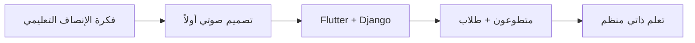

من منظور هندسة البرمجيات تغطي الوثيقة دورة الحياة: التحليل، التصميم، التنفيذ، الاختبار، والأفق المستقبلي — **للتقديم للمشرف** وللمناقشة النهائية.

---

## 2. المقدمة وخلفية المشروع

### 2.1 خلفية الموضوع

شهد التعليم الرقمي — ولا سيما بعد تسارع التحول الرقمي في المؤسسات التعليمية — توسعاً هائلاً في المنصات والتطبيقات والمحتوى المرئي. غير أن هذا التوسع بُني في أغلبه على **فرضية الإبصار**: أن المتعلم يرى الشاشة، يقرأ النص، يتابع الفيديو، ويختار العنصر باللمس البصري. وعندما يُطلب «إتاحة» هذا المحتوى للمكفوفين، تُضاف غالباً طبقة **قارئ الشاشة** (TalkBack على Android، VoiceOver على iOS) فوق واجهة لم تُكتب له.

هذا النموذج — الذي يُسمى أحياناً **Retrofit Accessibility** — ينجح أحياناً في الوصول إلى المعلومة، لكنه يفشل غالباً في بناء **تجربة تعليمية متكاملة**. السبب ليس تقنياً وحسب، بل **معمارياً وتربوياً**: المستخدم المكفوف يُجبر على استكشاف هيكل بصري (قوائم، أيقونات، ألوان، تخطيطات) عبر وصف صوتي متتابع، ما يزيد زمن إنجاز المهمة ويُشتت الانتباه عن المحتوى التعليمي ذاته.

من هنا تنبع **الحاجة إلى تصميم أصيل (Native Design)** للتعليم الصوتي: محتوى مسموع أو قابل للقراءة الآلية بجودة، أوامر منطوقة للتنقل، تقييم يقبل الإجابة الصوتية، ومسارات تعليمية تعكس المنطق المدرسي (صف، مادة، درس) لا منطق «صفحة ويب».

### 2.2 السياق العربي

في السياق العربي تتضاعف التحديات:

1. **شح المحتوى التعليمي الصوتي المنظم** المطابق للمناهج الرسمية.
2. **جودة متفاوتة** لمحركات TTS وSTT للغة العربية (لهجات، تشكيل، مصطلحات علمية).
3. **اعتماد الطالب** على قنوات غير رسمية (رسائل صوتية، مجموعات، تسجيلات فردية) بلا فهرسة ولا تقييم.
4. **غياب منصة** تجمع: منهج + اختبار + تتبع تقدم + مجتمع متطوعين في منتج واحد.

مشروع **بصيرة** يُقدَّم في هذا السياق كإجابة **هندسية–تربوية** قابلة للنقاش الأكاديمي، لا كمنتج تجاري جاهز للإطلاق الواسع فوراً.

### 2.3 ما الذي يحتاجه المتعلم المكفوف؟

| المحور | المعنى التربوي | المعنى العملي في بصيرة |
| ------ | -------------- | ---------------------- |
| **المحتوى** | مواد مطابقة للمرحلة الدراسية | Grade → Category → Lesson → LessonSection |
| **الاستماع** | صوت واضح بإيقاع مناسب | ملف بشري + TTS + تحكم إيقاف/متابعة |
| **التنقّل** | استقلالية دون مرافق | أوامر: التالي، السابق، توقف، استمر، بحث |
| **التقييم** | معرفة مستوى الفهم | Quiz، تصحيح آلي، مراجعة للمفتوح |
| **التتبع** | إحساس بالتقدم | LessonProgress: موضع، وقت استماع، إكمال |
| **المجتمع** | جودة واستدامة | TranscriptionReview، AudioRecording، VolunteerRole |

### 2.4 فكرة المشروع وتسمية «بصيرة»

**بصيرة** — من البصيرة بمعنى الفهم والإدراك — اسم يرمز إلى أن **فقدان البصر لا يلغي القدرة على الفهم العميق**. الرسالة الرمزية تدعم الرسالة التقنية: المنصة ليست «قارئ شاشة للمدرسة» بل **فضاء تعلّم صوتي**.

عملياً تجمع المنصة ستة محاور مترابطة:

1. **مكتبة هرمية** للمحتوى التعليمي.
2. **تحويل المحتوى** (PDF، نص، صوت) إلى تجربة استماع.
3. **تفاعل صوتي** للتنقل والبحث.
4. **اختبارات** متعددة الأنواع.
5. **نظام متطوعين** للجودة.
6. **تتبع تقدّم** الطالب.

### 2.5 نطاق المشروع

| ضمن النطاق | خارج النطاق (حالياً) | ملاحظة للمشرف |
| ---------- | --------------------- | -------------- |
| تطبيق Android/iOS/Web عبر Flutter (APK منشور لأندرويد) | تطبيق سطح مكتب منفصل | Flutter يغطي الجوال والويب |
| API REST للمحتوى والمصادقة منشور على استضافة حقيقية | نظام دفع أو اشتراكات | نموذج مجتمعي/تعليمي |
| إدارة صفوف ومواد ودروس بثلاثة أوضاع إدخال | منصة مؤتمرات حية | يمكن إضافتها لاحقاً |
| اختبارات مرتبطة بالدروس (اختيار، صح/خطأ، نصي، صوتي) | تلخيص AI متقدم | حقل summary موجود |
| أدوار المتطوعين ومراجعة التفريغ | منهاج وطني كامل | يحتاج شراكات |
| واجهة تعريفية لجمعية «نبض» مُخدَّمة من الخادم | بوابة إلكترونية كاملة للجمعية | صفحة تعريفية ثابتة فقط |

### 2.6 أسئلة المشروع — وكيف تجيب عنها الدراسة

| السؤال | إجابة مختصرة في هذه الوثيقة |
| ------ | ---------------------------- |
| كيف نصمّم تطبيقاً عربياً صوتياً؟ | Audio-first + أوامر محددة + TalkBack (باب 4، 18، 20) |
| ما البنية للصف→مادة→درس؟ | ERD و `lessons/models.py` (باب 14) |
| كيف ندمج بشري + TTS؟ | مساران متوازيان بلا تشغيل متزامن (باب 20) |
| كيف نضمن الجودة؟ | VolunteerRole + TranscriptionReview (باب 12) |
| حدود STT وOffline؟ | قيود + Hive مخطط (باب 26) |

---

## 3. الرؤية والرسالة والقيم

### 3.1 الرؤية

أن تصبح بصيرة جسراً رقمياً يمكّن الطلاب المكفوفين في الثانوية والجامعة من التعلّم الذاتي المنظم، بالصوت والكرامة والاستقلالية.

### 3.2 الرسالة

توفير منصة تعليمية صوتية عربية قابلة للتوسع، تربط محتوىً منظماً بتفاعل صوتي كامل ومجتمع متطوعين يضمن الجودة.

### 3.3 القيم

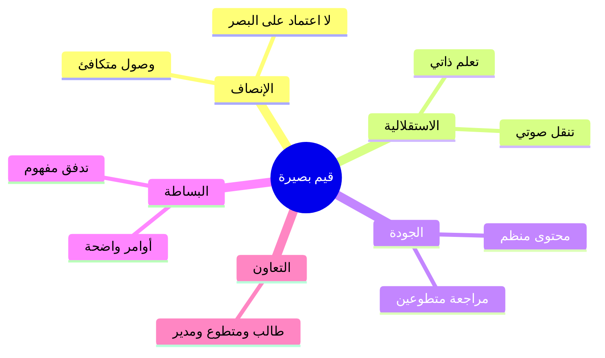

| القيمة | انعكاسها في المنتج |
| ------ | ------------------- |
| الإنصاف | مسارات مصممة للمكفوف لا «مكيّفة» لاحقاً |
| الاستقلالية | درس واختبار دون مرافق دائم |
| الجودة | حالات درس ومراجعة تفريغ |
| البساطة | أوامر محددة بدل حوار حر معقّد |
| التعاون | أدوار متطوعين مرتبطة بالمواد |

---

## 4. فلسفة التصميم: الصوت أولاً

### 4.1 ماذا تعني Audio-first؟

**Audio-first** ليست مجرد «إضافة TTS»، بل **إعادة ترتيب أولويات التصميم**: الصوت هو القناة **الأساسية** لإنجاز المهام، واللمس/البصر **مساران مساعدان**. في بصيرة، كل مهمة جوهرية — اختيار الصف، فتح الدرس، التشغيل، الإيقاف المؤقت، المتابعة، حل الاختبار، سماع النتيجة — **يجب** أن تكون قابلة للإنجاز صوتياً أو عبر قارئ شاشة بمسار منطقي قصير.

هذا يختلف جذرياً عن **Visual-first + Screen Reader**:

| Visual-first + SR | Audio-first (بصيرة) |
| ----------------- | ------------------- |
| الشاشة مصدر الحقيقة | الصوت/النص المنطوق مصدر الحقيقة |
| التنقل = استكشاف عناصر UI | التنقل = أوامر ومسارات تعليمية |
| الفيديو/الصورة محور | الصوت/النص المفروغ محور |
| الإتاحة «ملحق» | الإتاحة «أصل التصميم» |

### 4.2 طبقات التفاعل الصوتي

يُفهم النظام على أربع طبقات متراكمة؛ كل طبقة تبني على التي قبلها:

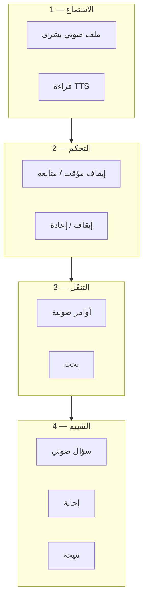

### 4.3 مبدأ المسارين المتوازيين

في شاشة الدرس يتعايش مساران **لكن لا يعملان معاً**:

1. **المسار البشري:** ملف `audio_file` عبر `audioplayers` — أغلى جودة وتعبير، مفضل للدروس المسجلة من متطوع.
2. **المسار الآلي:** `transcribed_text` أو `text_content` عبر `flutter_tts` — يغطي غياب الملف، المراجعة السريعة، أو محتوى مستخرج من PDF.

**القاعدة الذهبية:** بدء أحد المسارين **يوقف** الآخر فوراً. السبب معرفي (تجنب تداخل مصدرين) وعملي (تجنب تضارب STT/TTS مع الميكروفون). هذا قرار **UX** مبرر أمام المشرف، لا تفصيلاً ثانوياً.

### 4.4 مبادئ تصميم إضافية

| المبدأ | التطبيق |
| ------ | -------- |
| **البساطة الصوتية** | أوامر قصيرة محددة («التالي») لا حوار حر معقد |
| **التغذية الراجعة** | إعلان صوتي عند بدء/إيقاف/اكتمال |
| **المرونة** | أزرار لمس كبيرة عند فشل STT |
| **الاتساق** | نفس الأوامر في الدرس والاختبار حيث أمكن |
| **التدرج** | صف → مادة → درس — لا قفز عشوائي |

---

## 5. تحليل المشكلة والسياق

### 5.1 وصف المشكلة — بأبعادها

يمكن تشريح مشكلة الطالب المكفوف في التعليم الرقمي على **أربعة أبعاد**:

- **المعرفي:** صعوبة الوصول لمواد منظمة قابلة للبحث ومقسمة (عناوين، فقرات).
- **الزمني:** بطء التعلم مع التطبيقات العامة وقارئ الشاشة.
- **التقييمي:** غياب اختبارات ذاتية صوتية.
- **التنظيمي:** اعتماد على مساعدين وتسجيلات غير مفهرسة.

بصيرة **تنظّم** الدعم البشري لا تلغيه.

### 5.2 تحليل SWOT

| القوة (S) | الضعف (W) |
| --------- | --------- |
| تصميم صوتي أولاً | اعتماد على جودة STT/TTS للعربية |
| قابل للتوسع | حاجة لمتطوعين |
| بنية هرمية واضحة | Offline غير مكتمل |
| دعم Accessibility | ازدواجية نماذج اختبار (ملحق أ) |

| الفرص (O) | التهديدات (T) |
| --------- | -------------- |
| شراكات جمعيات المكفوفين | منافسة عالمية |
| Whisper و AI | تكلفة استضافة الصوت |
| مناهج رسمية | سياسات المتاجر |
| مؤسسات محلية | شح المحتوى عند الإطلاق |

### 5.3 لماذا الحل المقترح مناسب؟ — حجة للمشرف

الحل **ليس** «تطبيقاً واحداً يحل كل شيء»، بل **إطاراً** يجمع:

1. **تخصصاً في الفئة** (مكفوفون، عربي، مرحلة ثانوية–جامعية).
2. **تقنية حديثة** قابلة للصيانة (Flutter + Django).
3. **نموذجاً مجتمعياً** للاستدامة (متطوعون).
4. **فصلاً** بين إنتاج المحتوى (Backend + Admin + Volunteers) واستهلاكه (Flutter).

هذا الربط يجعل المشروع **قابلاً للتوسع** دون إعادة بناء من الصفر عند إضافة محتوى أو شركاء.

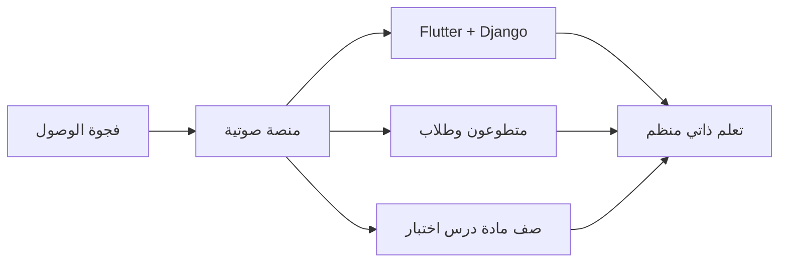

---

## 6. أهداف المشروع ومؤشرات النجاح

### 6.1 الهدف العام

منصة تعليمية صوتية متكاملة للتعلّم الذاتي المنظم عبر الهاتف، مع محتوى هرمي وتفاعل صوتي وتقييم ومجتمع مراجعة.

### 6.2 الأهداف التفصيلية

| # | الهدف | مؤشر النجاح |
| - | ----- | ----------- |
| 1 | مكتبة هرمية صف→مادة→درس | تصفح صوتي للتصنيفات |
| 2 | استماع وتنقل صوتي | أوامر التالي/السابق/أعد/توقف/استمر |
| 3 | تتبع التقدم | حفظ الموضع ووقت الاستماع |
| 4 | اختبارات صوتية | تصحيح آلي + مراجعة للمفتوحة |
| 5 | إشراك المتطوعين | تفريغ وتسجيلات وأدوار |
| 6 | تحويل PDF/نص | conversion_status وتقدم |
| 7 | إمكانية وصول عالية | TalkBack/VoiceOver وأزرار كبيرة |
| 8 | تحكم تشغيل موثوق | إيقاف ومتابعة من نفس الموضع |

### 6.3 أهداف أكاديمية

تحليل مشكلة حقيقية، تصميم ERD/UML متسق مع التنفيذ، نموذج أولي عامل يغطي مسارات الطالب والمتطوع، وتوثيق القيود بشفافية.

---

## 7. الإطار النظري والدراسات السابقة والأنظمة المشابهة

### 7.1 الإطار النظري

تستند بصيرة إلى تقاطع ثلاثة حقول:

**1. إمكانية الوصول (Web/App Accessibility):**  
معايير WCAG 2.1 تفرّق بين **Perceivable, Operable, Understandable, Robust**. بصيرة تركز على **Operable** و**Perceivable** عبر الصوت: ما لا يُرى يُسمع ويُقال.

**2. التصميم الشامل (Universal Design for Learning — UDL):**  
UDL يقترح قنوات متعددة للتمثيل والتفاعل والتعبير. بصيرة تقدّم: تمثيلاً صوتياً، تفاعلاً صوتياً، وتعبيراً صوتياً في الاختبارات.

**3. هندسة البرمجيات:**  
Client–Server، REST API، نمذجة بيانات علاقية، فصل الاهتمامات (core / lessons / tests / volunteers).

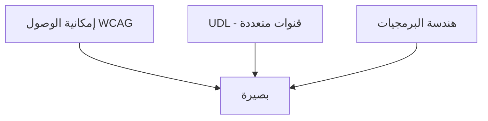

### 7.2 الدراسات والتجارب السابقة — مقارنة نوعية

| المصدر / الفئة | ما يقدمه | ما ينقصه بالنسبة لبصيرة |
| -------------- | -------- | ------------------------- |
| قارئ شاشة + LMS | وصول لمحتوى موجود | غير مصمم صوتياً؛ بطء؛ لا اختبارات صوتية متكاملة |
| كتب صوتية (Audible…) | جودة استماع | لا منهج مدرسي؛ لا اختبار؛ لا تتبع |
| تطبيقات قرآن/تجويد | نجاح في مجال ضيق | لا يغطي مواد ثانوية/جامعية |
| منصات MOOC | محتوى غني | تعتمد الفيديو؛ ضعيف للمكفوف |
| **بصيرة** | هرم منهجي + صوت + اختبار + متطوعون | يحتاج بناء محتوى عند الإطلاق |

### 7.3 دراسة الأنظمة المشابهة — مصفوفة الخصائص

تقارن المصفوفة التالية بصيرة بأربع فئات من الحلول المتاحة وفق سبعة معايير مستخلصة من احتياجات المتعلم المكفوف (باب 2.3):

| المعيار | قارئ شاشة + LMS | كتب صوتية | منصات MOOC | تطبيقات تجويد | **بصيرة** |
| ------- | :-------------: | :-------: | :--------: | :-----------: | :-------: |
| تصميم صوتي أولاً (لا طبقة لاحقة) | ✗ | ✓ | ✗ | ✓ | **✓** |
| بنية منهجية (صف / مادة / درس) | جزئي | ✗ | جزئي | ✗ | **✓** |
| محتوى عربي دراسي | جزئي | ✗ | محدود | ✓ (ديني فقط) | **✓** |
| اختبارات مع تصحيح | ✓ (بصري) | ✗ | ✓ (بصري) | ✗ | **✓ (صوتي/نصي)** |
| تتبع تقدّم الاستماع (موضع + وقت) | جزئي | ✓ | ✓ | جزئي | **✓** |
| مسار بشري + مسار TTS معاً | ✗ | ✗ | ✗ | ✗ | **✓** |
| مجتمع متطوعين مدمج في النموذج | ✗ | ✗ | ✗ | ✗ | **✓** |
| نقطة الضعف الرئيسة | بطء وإرهاق معرفي | لا منهج ولا تقييم | يعتمد الفيديو | مجال ضيق | يحتاج بناء محتوى |

**التميز التنافسي لبصيرة — للمناقشة:**  
(1) Audio-first أصيل لا retrofitted.  
(2) هيكل صف/مادة/درس يعكس الواقع التعليمي العربي.  
(3) اختبارات صوتية مع تصحيح هجين.  
(4) دور المتطوعين مدمج في نموذج البيانات لا كفكرة جانبية.  
(5) مساران للصوت (بشري + TTS) بقواعد واضحة.

---

## 7ب. دراسة الجدوى

### 7ب.1 الجدوى التقنية

| المعيار | التقييم | التبرير |
| ------- | ------- | ------- |
| توفر التقنيات | **عالٍ** | Flutter، Django، STT/TTS متوفرة ومفتوحة |
| تعقيد التكامل | **متوسط** | REST واضح؛ الصوت يحتاج اختباراً يدوياً |
| قابلية التوسع | **عالٍ** | فصل Client/Server؛ PostgreSQL لاحقاً |
| STT العربي | **متوسط–منخفض** | يُخفّف بأوامر محددة وأزرار |

**الخلاصة:** الجدوى التقنية **مؤكدة** لنموذج تخرج؛ التحدي في **جودة الصوت** لا في البنية.

### 7ب.2 الجدوى الاقتصادية

- **تكلفة تطوير:** منخفضة نسبياً (أدوات مفتوحة، فريق طلاب).
- **تكلفة تشغيل:** استضافة + تخزين ملفات صوتية — تتزايد مع المحتوى.
- **نموذج إيراد:** خارج نطاق المشروع الحالي (تعليمي/مجتمعي).

### 7ب.3 الجدوى التشغيلية

- **يتطلب:** متطوعين لمراجعة التفريغ؛ مدير محتوى (Admin).
- **بدون متطوعين:** TTS وWhisper يعملان لكن **الجودة التربوية** تتراجع.

### 7ب.4 الجدوى الزمنية

جدول Gantt في الباب 24 (8 أشهر تقريباً) **واقعي** لفريق 2–3 طلاب مع مشرف.

### 7ب.5 توصية الجدوى للمشرف

**المشروع مجدٍ أكاديمياً وتقنياً** كمشروع تخرج، بشرط:  
(1) تحديد نطاق محتوى تجريبي (صف واحد، 2–3 مواد).  
(2) اختبار UAT مع مستخدم واحد على الأقل من الفئة المستهدفة إن أمكن.  
(3) توثيق القيود بصراحة في المناقشة.

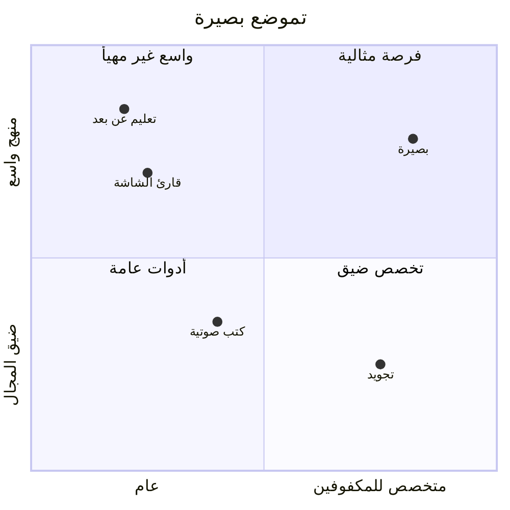

---

## 8. تحليل المتطلبات

يترجم هذا الباب الحاجة الإنسانية إلى متطلبات **قابلة للقياس والاختبار والمناقشة** أمام المشرف. اعتُمدت صيغة: **رمز + وصف + أولوية + معيار قبول مختصر**.

### 8.0 منهجية جمع المتطلبات

1. **تحليل المشكلة** والسيناريوهات (أبواب 5، 11).
2. **مراجعة الكود** (`models.py`, `views.py`, Flutter services).
3. **معايير إمكانية الوصول** WCAG وTalkBack.
4. **أولوية MoSCoW** ضمنياً: Must (عالية)، Should (متوسطة)، Could (منخفضة).

### 8.1 المتطلبات الوظيفية — جدول ملخّص


| الرمز | المتطلب                                | الأولوية |
| ----- | -------------------------------------- | -------- |
| FR-01 | تسجيل مستخدم جديد (طالب / متطوع)       | عالية    |
| FR-02 | تسجيل الدخول والحصول على ملف شخصي      | عالية    |
| FR-03 | عرض الصفوف الدراسية والمواد والدروس    | عالية    |
| FR-04 | تشغيل الدرس صوتياً (ملف أو TTS)        | عالية    |
| FR-05 | التنقل بين أقسام الدرس صوتياً          | عالية    |
| FR-06 | حفظ موضع الاستماع ووقت الاستماع        | عالية    |
| FR-07 | البحث في المحتوى (نصي/صوتي)            | متوسطة   |
| FR-08 | بدء محاولة اختبار وإرسال إجابات        | عالية    |
| FR-09 | تصحيح تلقائي لأسئلة الاختيار وصح/خطأ   | عالية    |
| FR-10 | مراجعة متطوع للإجابات المفتوحة/الصوتية | عالية    |
| FR-11 | رفع ومراجعة تفريغ الدروس               | عالية    |
| FR-12 | رفع تسجيل صوتي من متطوع                | متوسطة   |
| FR-13 | استخراج نص من PDF وتحويله لصوت         | متوسطة   |
| FR-14 | تلخيص درس (حقل summary)                | منخفضة   |
| FR-15 | إدارة أدوار المتطوعين حسب المادة       | متوسطة   |
| FR-16 | إدخال الدرس من لوحة الإدارة بثلاثة أوضاع (نص / صوت / PDF) | عالية |
| FR-17 | إخفاء الإجابة الصحيحة عن الطالب حتى تسليم المحاولة | عالية |

### 8.1ب شرح تفصيلي لمجموعات المتطلبات

**المصادقة والهوية (FR-01, FR-02):**  
نموذج `User` في `core` يميّز `student`, `volunteer`, `admin`. المصادقة عبر Token (DRF)، ويُعاد الرمز عند **التسجيل** كما عند الدخول حتى لا يبقى الحساب الجديد بلا صلاحية. **معيار القبول:** تسجيل/دخول ناجح ← Token ← الوصول لـ `profile` وواجهات الاختبارات.

**المحتوى والاستماع (FR-03 – FR-07, FR-16):**  
هرم Grade → Category → Lesson → LessonSection. يُدخِل المشرف الدرس بأحد ثلاثة أوضاع: **نص مباشر** (`text_content`)، أو **ملف صوتي بشري** (`audio_file`)، أو **PDF** يُستخرج نصه ثم يُحوَّل صوتاً آلياً عبر إشارات `post_save`. يشغّل التطبيق `audio_file` أو يقرأ النص بـ TTS. `LessonProgress` يحفظ `current_position` و`listening_time_seconds` عبر `update_progress`. **معيار القبول:** طالب يستأنف من موضع الإيقاف، ويظهر تقدمه في لوحة الإدارة.

**الاختبارات (FR-08 – FR-10, FR-17):**  
Quiz (مرتبط بدرس منشور) → Question → Choice → QuizAttempt → Answer. تصحيح آلي لـ `multiple_choice` و`true_false` مع تطبيع الصيغ العربية/الإنجليزية («صح/صحيح/true»)؛ الإجابات النصية والصوتية تُعلَّم `reviewed=false` حتى يراجعها متطوع. يُخفي `ChoicePublicSerializer` حقل `is_correct` قبل التسليم. **معيار القبول:** `passed=true` عند `score ≥ passing_score`، ورفض أي إجابة بعد إنهاء المحاولة.

**المتطوعون والتحويل (FR-11 – FR-15):**  
TranscriptionReview، AudioRecording، VolunteerRole. `conversion_status` لتتبع PDF→نص→صوت (idle → extracting_text → text_extracted → converting_audio → completed/failed). **معيار القبول:** درس ينتقل draft → review → approved → published بعد مراجعة.

### 8.2 المتطلبات غير الوظيفية (Non-Functional Requirements)


| الرمز  | المتطلب             | المعيار المقترح                                                |
| ------ | ------------------- | -------------------------------------------------------------- |
| NFR-01 | **إمكانية الوصول**  | WCAG 2.1 مستوى AA حيث ينطبق                                    |
| NFR-02 | **الأداء**          | استجابة API < 2 ثانية للقوائم                                  |
| NFR-03 | **الأمان**          | Token authentication؛ HTTPS في الإنتاج                         |
| NFR-04 | **قابلية التوسع**   | فصل Frontend/Backend؛ قاعدة بيانات قابلة للترقية لـ PostgreSQL |
| NFR-05 | **الموثوقية**       | تتبع حالة فشل التحويل (conversion_error)                       |
| NFR-06 | **قابلية الصيانة**  | تطبيقات Django منفصلة (core, lessons, tests, volunteers)       |
| NFR-07 | **دعم العربية**     | واجهات ونماذج بأسماء عربية (verbose_name)                      |
| NFR-08 | **العمل دون اتصال** | تخزين محلي (Hive) — مخطط توسعه                                 |

### 8.3 مصفوفة تتبع المتطلبات → المكونات

| المتطلب | Backend (ملف / صنف) | Flutter (ملف) | جدول / خدمة |
| ------- | ------------------- | ------------- | ----------- |
| FR-01, FR-02 | `core/views.py` — RegisterView, LoginView, ProfileView | `auth_service.dart`, `login_screen.dart` | User, Token |
| FR-03 | `lessons/views.py` — GradeViewSet, CategoryViewSet, LessonViewSet | `home_screen`, `grade_subjects_screen`, `category_lessons_screen` | Grade, Category, Lesson |
| FR-04, FR-05 | Lesson.audio_file / transcribed_text | `lesson_detail_screen`, `speech_service`, `voice_command_service` | Lesson, LessonSection |
| FR-06 | LessonViewSet.update_progress / get_progress | `lesson_service.updateProgress` | LessonProgress |
| FR-07 | LessonViewSet.search | `lesson_service.search` | Lesson |
| FR-08, FR-09, FR-17 | `tests/views.py` — QuizViewSet (start_attempt, submit_answer, submit_attempt), ChoicePublicSerializer | `quizzes_screen`, `quiz_take_screen`, `quiz_service` | Quiz, Question, Choice, QuizAttempt, Answer |
| FR-10, FR-11, FR-12 | `volunteers/views.py` — TranscriptionReviewViewSet.approve, AudioRecordingViewSet | (لوحة الإدارة حالياً) | TranscriptionReview, AudioRecording |
| FR-13, FR-16 | `lessons/signals.py`, `text_conversion_service.py`, `tts_service.py`, `admin.py` | `admin/upload_lesson_screen` | Lesson.conversion_status |
| FR-15 | VolunteerRoleViewSet.my_roles | — | VolunteerRole |
| NFR-01 | — | `accessibility_service`, `accessible_button`, `accessible_list_tile` | Semantics |
| NFR-03 | TokenAuthentication، IsAuthenticated على المحاولات، CORS من البيئة | حفظ الرمز في SharedPreferences | — |

---

## 9. تحليل أصحاب المصلحة

فهم **من يتأثر بالنظام ومن يؤثر فيه** شرط لنجاح التصميم. في بصيرة توجد علاقة **ثلاثية**: طالب يستهلك، متطوع ينتج ويراجع، مدير ينشر ويحكم.

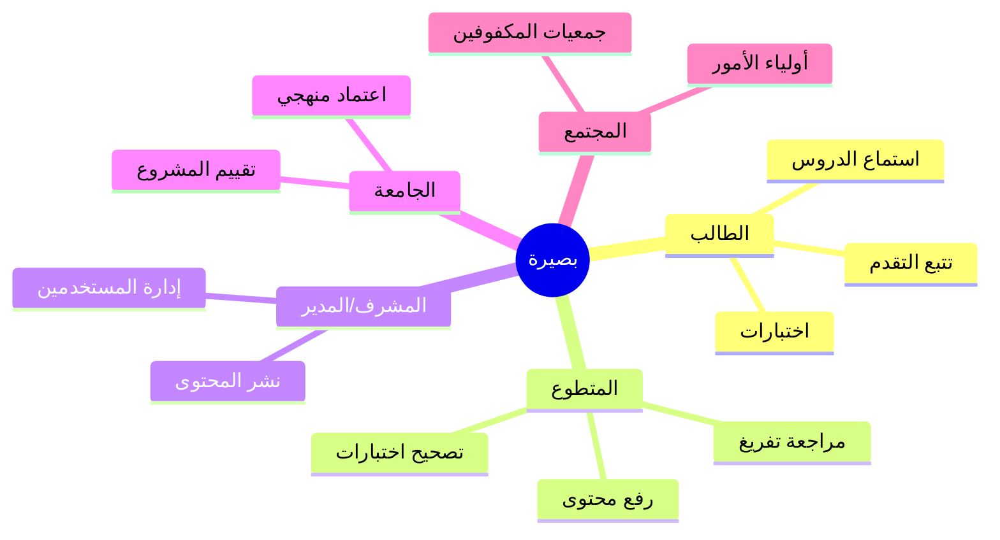


| صاحب المصلحة       | الدور         | الاحتياجات               |
| ------------------ | ------------- | ------------------------ |
| **الطالب المكفوف** | مستخدم أساسي  | تعلم ذاتي، صوت، بساطة    |
| **المتطوع**        | إنتاج ومراجعة | واجهة مراجعة، مهام واضحة |
| **مدير النظام**    | إدارة         | لوحة Django Admin        |
| **لجنة التخرج**    | تقييم         | وثائق، عرض، اختبارات     |
| **مؤسسة تعليمية**  | محتوى         | مناهج مطابقة للصفوف      |


---


## 10. حالات الاستخدام


### 10.1 مخطط حالات الاستخدام (Use Case Diagram)

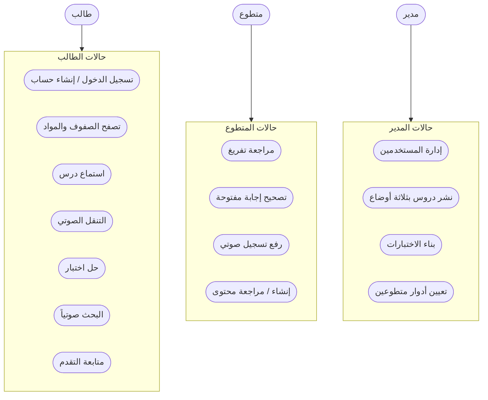

يشترك المتطوع والمدير مع الطالب في حالة **تسجيل الدخول**؛ ويتميّز المتطوع بأنه قد يؤدي أيضاً حالات الطالب (الاستماع والتصفح) للتحقق من جودة المحتوى قبل اعتماده.


### 10.2 جدول حالات الاستخدام التفصيلية


#### UC-03: استماع درس


| البند              | الوصف                                                                                                                         |
| ------------------ | ----------------------------------------------------------------------------------------------------------------------------- |
| **الممثل**         | طالب                                                                                                                          |
| **الشرط المسبق**   | مسجل دخول؛ الدرس منشور (published)                                                                                            |
| **التدفق الرئيسي** | 1. يختار صفاً → مادة → درس. 2. يبدأ التشغيل الصوتي. 3. النظام يحدّث LessonProgress. 4. يستخدم أوامر صوتية للتنقل بين الأقسام. |
| **التدفق البديل**  | لا يوجد ملف صوتي → قراءة TTS من transcribed_text أو text_content                                                              |
| **الشرط اللاحق**   | حفظ current_position و listening_time_seconds                                                                                 |
| **الاستثناء**      | انقطاع الشبكة → تشغيل من التخزين المحلي (مستقبلي)                                                                             |


#### UC-05: حل اختبار صوتي


| البند              | الوصف                                                                                                               |
| ------------------ | ------------------------------------------------------------------------------------------------------------------- |
| **الممثل**         | طالب                                                                                                                |
| **الشرط المسبق**   | اختبار نشط؛ لم يتجاوز max_attempts                                                                                  |
| **التدفق الرئيسي** | 1. start_attempt. 2. قراءة السؤال صوتياً. 3. إرسال إجابة (نص/صوت/اختيار). 4. submit_attempt. 5. عرض النتيجة صوتياً. |
| **التدفق البديل**  | سؤال مفتوح → needs_review=true حتى يراجع متطوع                                                                      |
| **الشرط اللاحق**   | تحديث QuizAttempt: score, percentage, passed                                                                        |


#### UC-08: مراجعة تفريغ


| البند              | الوصف                                                                                                                          |
| ------------------ | ------------------------------------------------------------------------------------------------------------------------------ |
| **الممثل**         | متطوع (دور transcriber أو reviewer)                                                                                            |
| **التدفق الرئيسي** | 1. يفتح درساً بحالة review. 2. يعدّل transcribed_text. 3. يسجل TranscriptionReview. 4. يحدّث حالة الدرس إلى approved/published |


---


## 11. رحلة المستخدم والسيناريوهات السردية

هذا الفصل يحوّل المتطلبات التقنية إلى قصص حية تساعد اللجنة والقارئ غير التقني على تخيّل المنتج.

### 11.1 شخصية الطالب: «سارة» (17 سنة)

سارة طالبة في الصف الحادي عشر، تستخدم TalkBack يومياً. تريد مراجعة دروس اللغة الإنجليزية قبل الاختبار دون انتظار تسجيلات عشوائية عبر واتساب. تدخل بصيرة، تختار صفها، ثم المادة، ثم درساً منشوراً. تبدأ بالملف الصوتي البشري، توقف مؤقتاً عند الباب، ثم تتابع من نفس الموضع. لاحقاً تطلب «قراءة النص» للمراجعة السريعة، ثم تحل اختباراً قصيراً وتسمع نتيجتها.

### 11.2 شخصية المتطوع: «أحمد»

أحمد متطوع بصوت واضح. يستلم مهمة مراجعة تفريغ درس، يعدّل النص، يعتمد المراجعة، وقد يرفع تسجيلاً بشرياً بديلاً عن TTS إن لزم.

### 11.3 مخطط رحلة الطالب

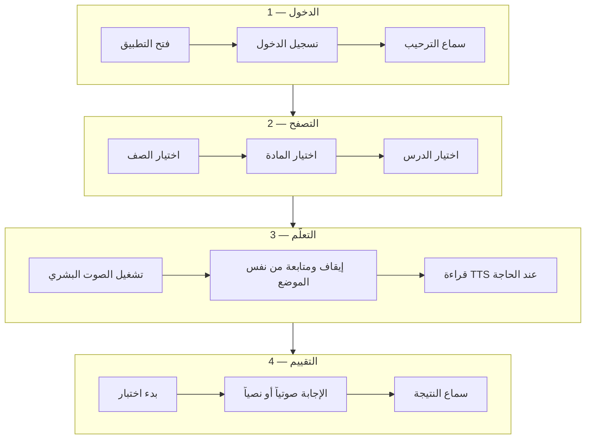

| المرحلة | الخطوة | مستوى الرضا المتوقع (1–5) | ما يضمنه النظام |
| ------- | ------ | :-----------------------: | --------------- |
| الدخول | فتح التطبيق وتسجيل الدخول | 4 | ترحيب صوتي وحفظ الرمز محلياً |
| التصفح | صف ← مادة ← درس | 4 | قوائم قابلة للوصول وعدد الدروس لكل مادة |
| التعلّم | تشغيل / إيقاف / متابعة | 5 | استئناف من نفس الموضع وحفظ التقدّم |
| التعلّم | قراءة TTS | 4 | سرعة وطبقة صوت قابلتان للضبط |
| التقييم | الإجابة وسماع النتيجة | 3–5 | تصحيح فوري للموضوعية، ومراجعة للمفتوحة |

### 11.4 سيناريو سردي موسّع — يوم دراسي

في المساء، تفتح سارة التطبيق. يقرأ النظام ترحيباً قصيراً. تنتقل صوتياً: «الصف الحادي عشر» → «إنجليزي» → «سيرة ذاتية». يبدأ التسجيل البشري. عند الدقيقة الثالثة يرن جرس المنزل؛ تقول «توقف» أو تضغط الإيقاف المؤقت. بعد دقيقتين تتابع فيكمل من موضعها لا من البداية — نقطة حاسمة في جودة التجربة. تنهي الدرس، تحل ثلاثة أسئلة اختيار من متعدد، وتسمع: «نجحت بنسبة ثمانين بالمئة».

### 11.5 سيناريو المتطوع — ضمان الجودة

أحمد يفتح قائمة المراجعات، يستمع للمقطع، يصحح أخطاء التفريغ الآلي، يضيف ملاحظة، ويعتمد النص. يتحوّل الدرس تدريجياً نحو حالة النشر بعد مسار الاعتماد المعتمد في النظام.

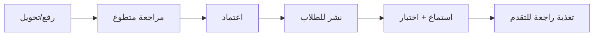

---


## 12. تحليل النظام ونموذج العمل

بعد تحديد الـ«ماذا»، يشرح هذا الباب الـ«كيف» على مستوى العمل ودورة حياة المحتوى قبل الدخول في تفاصيل الواجهات والجداول.


### 12.1 نموذج العمل (Business Model)

يعتمد المشروع على **نموذج مجتمعي + تقني**:

1. **إدخال المحتوى:** PDF / نص / تسجيل صوتي.
2. **المعالجة:** استخراج نص (PyPDF2/pdfplumber) → تفريغ (Whisper اختياري) → TTS (gTTS).
3. **المراجعة البشرية:** متطوعون يعتمدون النص.
4. **النشر:** حالة الدرس published.
5. **الاستهلاك:** طالب يستمع ويختبر.
6. **التقييم:** آلي + مراجعة متطوع.


### 12.2 سير عمل المحتوى (Content Lifecycle)

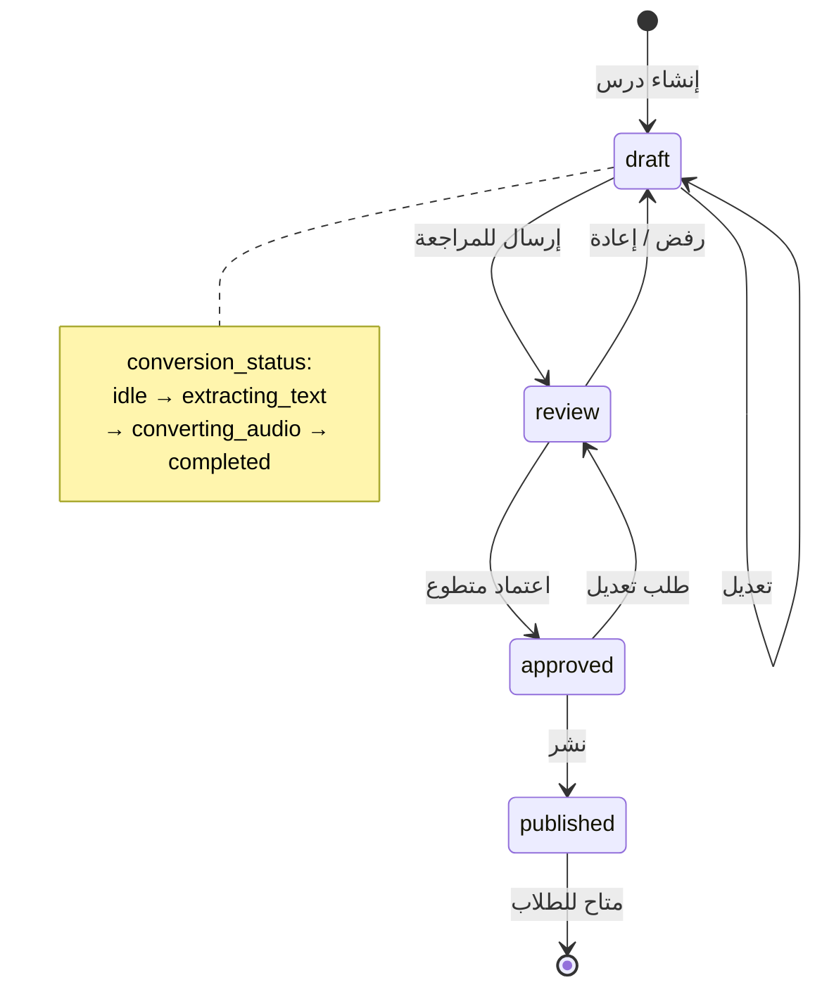


### 12.3 سير عمل التحويل (PDF/نص → صوت)

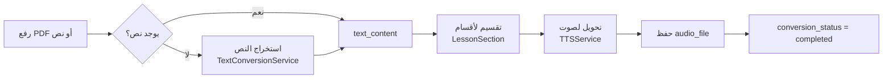


### 12.4 تحليل البيانات الهرمية

```
Grade (الصف الدراسي)
 └── Category (المادة الدراسية)
      ├── Lesson (الدرس)
      │    ├── LessonSection (فقرات / عناوين / نقاط)
      │    ├── LessonProgress (تقدم الطالب)
      │    ├── TranscriptionReview (مراجعة تفريغ من متطوع)
      │    └── Quiz (الاختبار — تطبيق tests)
      │         ├── Question
      │         │    └── Choice
      │         └── QuizAttempt
      │              └── Answer
      └── VolunteerRole (متطوع مرتبط بمادة)
```

يلاحَظ أن **الاختبار يتبع الدرس مباشرة** لا المادة؛ وهو قرار مقصود يضمن ألا يظهر للطالب اختبارٌ لدرس غير منشور، ويجعل تبويب «الاختبارات» داخل المادة يعرض اختبارات دروسها فقط (فلتر `?category=`).

---


## 13. تصميم النظام والبنية المعمارية

يعتمد التصميم على فصل الطبقات: عرض جوال، خدمات تطبيق، API، منطق أعمال، وبيانات/وسائط — بما يسهّل الصيانة والتوسع.

### 13.0 مقدمة — قرارات معمارية للمناقشة

اعتُمد نمط **Client–Server** لفصل العرض (Flutter) عن منطق الأعمال والبيانات (Django). **مبررات هذا الاختيار أمام المشرف:**

1. **تعدد المنصات:** Flutter يخدم Android/iOS/Web من قاعدة واحدة.
2. **إدارة محتوى مركزية:** Admin + API يسمحان بإضافة دروس دون تحديث التطبيق.
3. **أمان:** Token على الخادم؛ لا تخزين كلمات مرور في التطبيق.
4. **قابلية التوسع:** التبديل بين SQLite وMySQL بمتغير بيئة واحد دون تغيير Flutter.


### 13.1 البنية المعمارية (Architecture)

يتبع المشروع نمط **Client-Server** مع **طبقات منفصلة**:

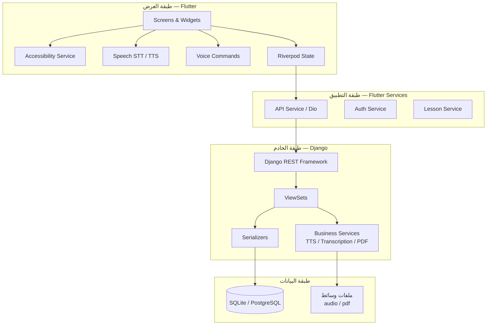


### 13.2 مخطط المكونات (Component Diagram)

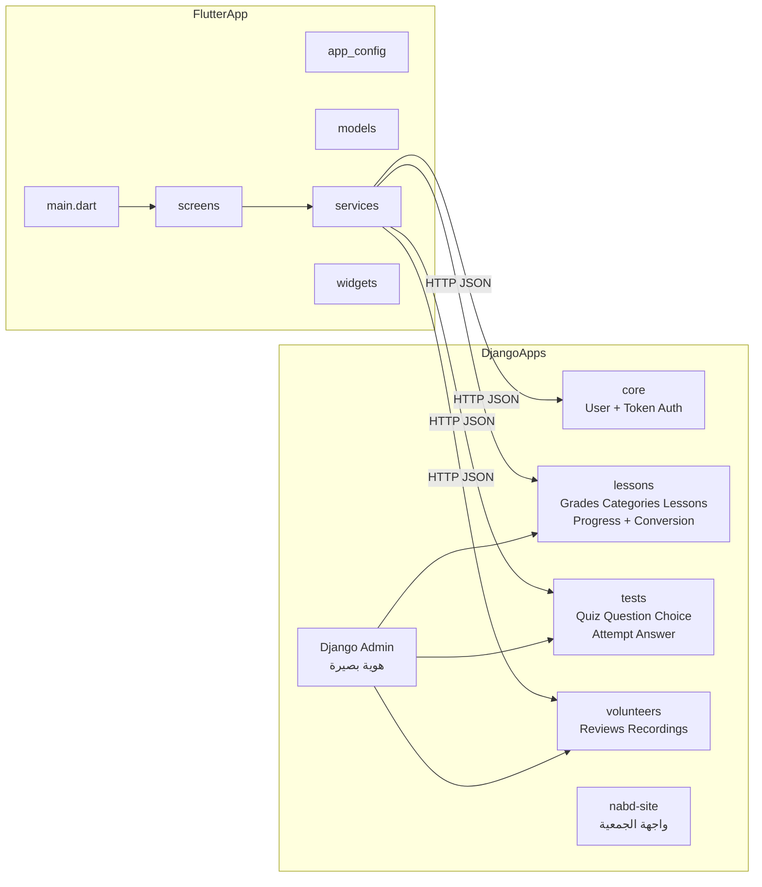


### 13.3 النشر (Deployment Diagram)

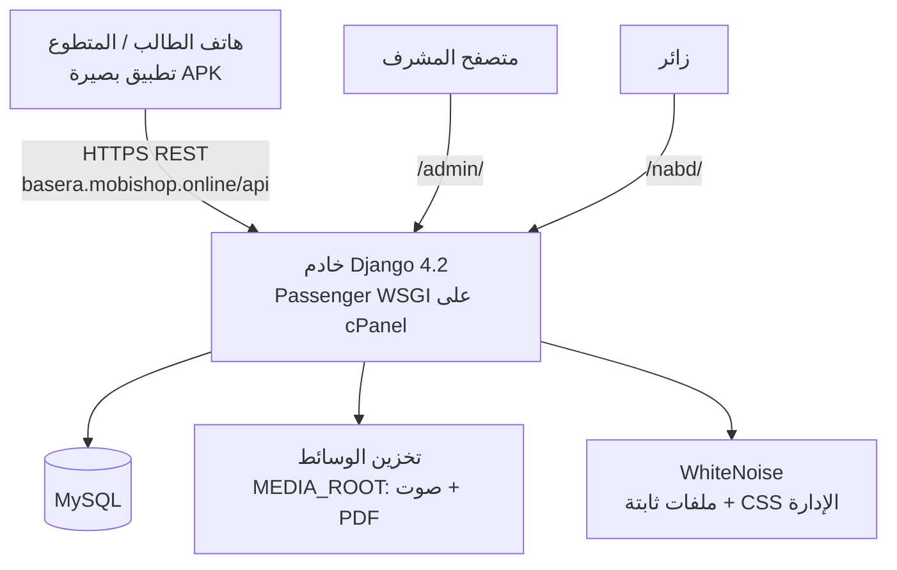

**بيئتا التشغيل:**

| البند | التطوير المحلي | الإنتاج |
| ----- | -------------- | ------- |
| الخادم | `manage.py runserver` على `127.0.0.1:8000` عبر `start.bat` | Namecheap Stellar (cPanel Python App + `passenger_wsgi.py`) |
| قاعدة البيانات | SQLite (`db.sqlite3`) | MySQL (`DB_ENGINE=mysql` في `.env`) |
| عنوان الـ API في التطبيق | `--dart-define=USE_LOCAL_API=true` ← `http://10.0.2.2:8000/api` (محاكي) أو `127.0.0.1` | `https://basera.mobishop.online/api` (الافتراضي في `AppConfig`) |
| الإعدادات الحساسة | `.env` محلي | `.env` على الخادم: `DEBUG=False`, `SECRET_KEY`, `ALLOWED_HOSTS`, `CSRF_TRUSTED_ORIGINS` |
| التفريغ الصوتي (Whisper) | متاح محلياً | غير مثبَّت على الاستضافة المشتركة (يُنفَّذ محلياً ثم يُرفع النص) |


---


## 14. مخطط الكيانات والعلاقات (ERD)

### 14.0 مقدمة — فلسفة نموذج البيانات

صُمّم ERD ليعكس **ثلاث مجالات** مترابطة:

1. **المحتوى التعليمي:** Grade → Category → Lesson → LessonSection
2. **التعلّم والتقييم:** LessonProgress، Quiz، Question، Choice، QuizAttempt، Answer
3. **المجتمع والجودة:** VolunteerRole، TranscriptionReview، AudioRecording

هذا التقسيم يسهّل على المشرف متابعة **أي جدول يخدم أي مسار** (طالب / متطوع / مدير).


### 14.1 الكيانات الرئيسية


#### كيان المستخدم (User) — تطبيق `core`


| الحقل                     | النوع    | الوصف                       |
| ------------------------- | -------- | --------------------------- |
| id                        | PK       | معرف                        |
| username, email, password | —        | مصادقة Django               |
| user_type                 | enum     | student / volunteer / admin |
| phone_number              | string   | اختياري                     |
| created_at, updated_at    | datetime | تتبع                        |


#### كيان الصف (Grade)


| الحقل       | النوع  | الوصف       |
| ----------- | ------ | ----------- |
| id          | PK     | معرف الصف   |
| name        | string | اسم الصف (مثال: الصف التاسع، البكالوريا، جامعي) |
| description | text   | وصف اختياري |
| order       | int    | ترتيب العرض في التطبيق |
| is_active   | bool   | إخفاء الصف من التطبيق دون حذفه |


#### كيان المادة (Category)


| الحقل                   | النوع      | الوصف |
| ----------------------- | ---------- | ----- |
| id                      | PK         | معرف المادة |
| grade_id                | FK → Grade | الصف الذي تنتمي إليه المادة (CASCADE) |
| name, description, icon | string / text / string | اسم المادة ووصفها ورمزها |
| order, is_active        | int / bool | ترتيب العرض وتفعيل المادة |
| lessons_count()         | خاصية محسوبة | عدد الدروس المنشورة فقط |


#### كيان الدرس (Lesson)


| الحقل                                  | النوع         | الوصف           |
| -------------------------------------- | ------------- | --------------- |
| id                                     | PK            | معرف الدرس      |
| category_id                            | FK → Category | المادة (CASCADE) |
| title, description                     | string / text | عنوان الدرس ووصفه |
| audio_file, pdf_file                   | file          | التسجيل البشري / ملف PDF المصدر |
| text_content, transcribed_text         | text          | النص المُدخل مباشرة أو المستخرج / النص المفروغ من الصوت |
| transcribed_text_reviewed              | bool          | هل راجع متطوع النص المفروغ |
| conversion_status, conversion_progress, conversion_error | enum / int / text | تتبع سلسلة PDF ← نص ← صوت ونسبة التقدم ورسالة الخطأ |
| duration, status                       | int / enum    | مدة الصوت بالثواني، وحالة النشر draft…published |
| created_by, reviewed_by                | FK → User     | منشئ الدرس ومراجعه (SET_NULL) |
| summary                                | text          | ملخص (للتلخيص الذكي مستقبلاً) |
| created_at, updated_at, published_at   | datetime      | تتبع زمني       |


#### كيان قسم الدرس (LessonSection)


| الحقل                        | النوع                       | الوصف |
| ---------------------------- | --------------------------- | ----- |
| lesson_id                    | FK → Lesson                 | الدرس الأب (CASCADE) |
| section_type                 | paragraph / heading / point | نوع القسم لتغيير نبرة القراءة والتنقل |
| text, order                  | text / int                  | نص القسم وترتيبه |
| audio_timestamp              | float                       | موضع القسم في الملف الصوتي بالثواني |


#### كيان تقدم الدرس (LessonProgress)


| الحقل                       | النوع                | الوصف |
| --------------------------- | -------------------- | ----- |
| user_id, lesson_id          | FK (unique together) | سجل واحد لكل طالب ودرس |
| completed, current_position | bool / float         | اكتمال الدرس وموضع الاستئناف بالثواني |
| listening_time_seconds      | int                  | إجمالي وقت الاستماع المتراكم |
| last_accessed               | datetime             | آخر وصول (يُحدَّث آلياً) |


#### كيان الاختبار (Quiz) — تطبيق `tests` (المسار الحي)


| الحقل                   | النوع         | الوصف                                   |
| ----------------------- | ------------- | --------------------------------------- |
| id                      | PK            |                                         |
| lesson_id               | FK → Lesson   | الاختبار يتبع درساً محدداً (CASCADE)    |
| title, description      | string / text |                                         |
| passing_score           | int (افتراضي 70) | نسبة النجاح المطلوبة                 |
| created_at, updated_at  | datetime      |                                         |


#### كيان السؤال (Question) والخيار (Choice)


| Question | Choice |
| -------- | ------ |
| quiz_id (FK)، question_text، question_audio (ملف اختياري) | question_id (FK) |
| question_type: multiple_choice / true_false / text_answer / audio_answer | choice_text |
| order، points (افتراضي 1) | is_correct — **لا يُرسل للطالب قبل التسليم** |


#### كيان المحاولة (QuizAttempt) والإجابة (Answer)


| QuizAttempt | Answer |
| ----------- | ------ |
| user_id, quiz_id (FK) | attempt_id, question_id (FK) |
| score (نسبة مئوية)، passed | answer_text، answer_audio، selected_choice |
| started_at، completed_at (فارغ حتى التسليم) | is_correct، points_earned، reviewed، reviewed_by |

> **ملاحظة تصميمية:** يُحسب `score` في `submit_attempt` كنسبة النقاط المكتسبة إلى إجمالي النقاط، ويُغلق `completed_at` المحاولة فتُرفض أي إجابة لاحقة. يحتفظ تطبيق `lessons` بنموذج اختبارات موسّع (نوع الاختبار، مدة، حد محاولات، `needs_review`) غير مفعّل في التطبيق؛ يُناقش في الملحق أ كخارطة طريق للتوحيد.


#### كيان دور المتطوع (VolunteerRole)


| الحقل                              | النوع                                                            |
| ---------------------------------- | ---------------------------------------------------------------- |
| user_id, role                      | reviewer / transcriber / quiz_reviewer / content_creator / admin |
| category_id                        | اختياري                                                          |
| tasks_completed, tasks_in_progress |                                                                  |


#### كيانات المتطوعين — تطبيق `volunteers`


| TranscriptionReview    | AudioRecording                 |
| ---------------------- | ------------------------------ |
| lesson_id, reviewer_id | title, audio_file, recorded_by |
| reviewed_text, status  | status: pending → published    |
| comments               | transcribed_text, notes        |


### 14.2 مخطط ERD (Mermaid)

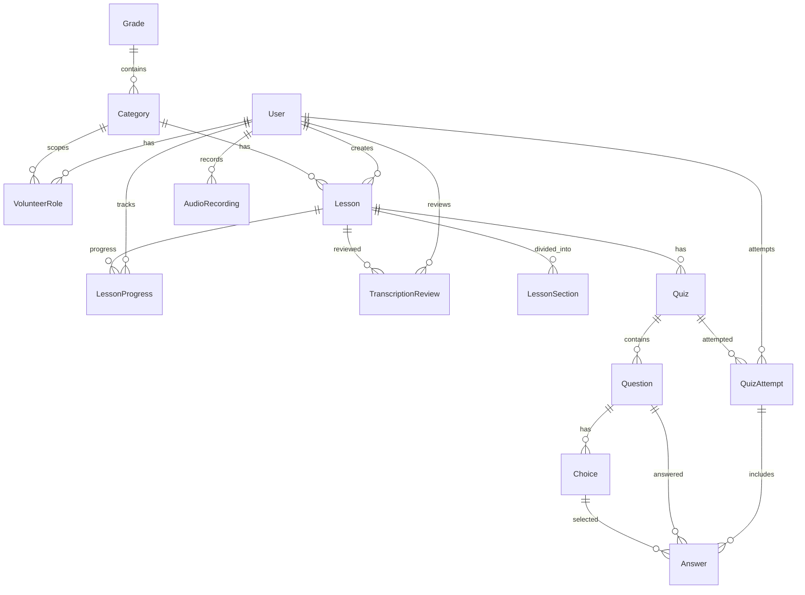


### 14.3 قاموس البيانات (Data Dictionary) — ملخص العلاقات


| العلاقة                          | النوع | القيود                     |
| -------------------------------- | ----- | -------------------------- |
| Grade → Category                 | 1:N   | on delete CASCADE          |
| Category → Lesson                | 1:N   | on delete CASCADE          |
| Lesson → LessonSection           | 1:N   | ترتيب بـ order             |
| User + Lesson → LessonProgress   | N:M   | unique_together (user, lesson) |
| Lesson → Quiz                    | 1:N   | on delete CASCADE؛ يُعرض فقط إن كان الدرس published |
| Quiz → Question → Choice         | 1:N:N | ترتيب الأسئلة بـ order     |
| User + Quiz → QuizAttempt        | N:M   | محاولات متعددة مسموحة      |
| QuizAttempt → Answer             | 1:N   | إجابة واحدة لكل سؤال (تُحدَّث لا تُكرَّر) |
| Choice → Answer.selected_choice  | 1:N   | on delete SET_NULL         |
| User + Role + Category → VolunteerRole | N:M | unique_together (user, role, category) |


---


## 15. مخططات UML


### 15.1 مخطط الفئات (Class Diagram) — منطق المجال

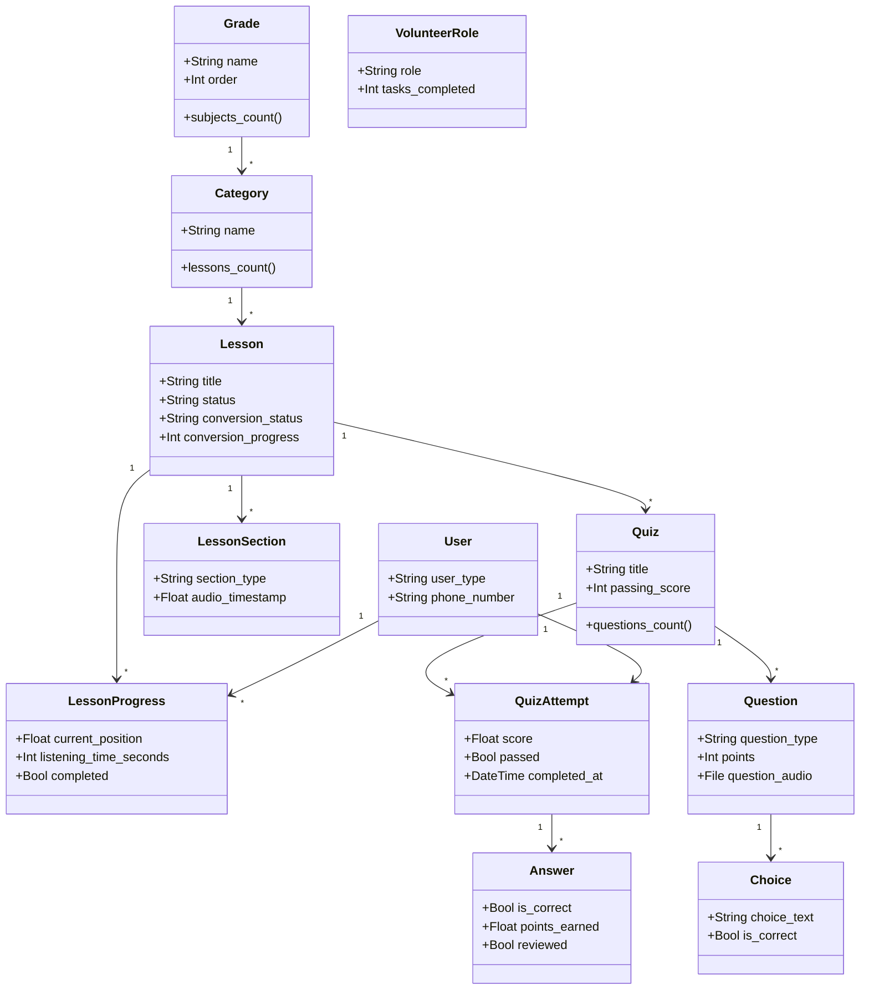


### 15.2 مخطط تسلسل — تسجيل الدخول واستماع درس

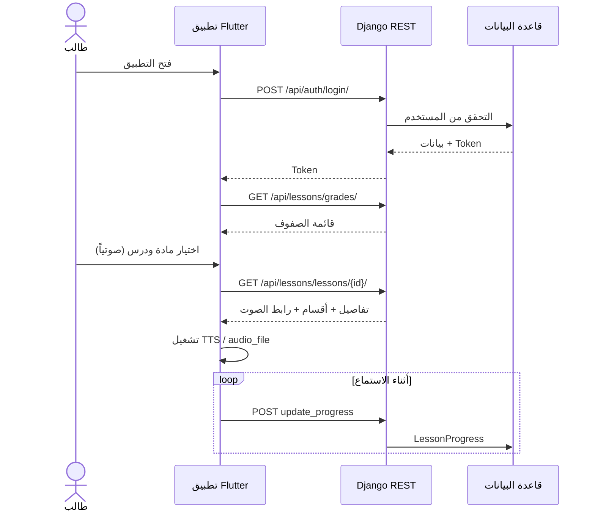


### 15.3 مخطط تسلسل — إنهاء اختبار

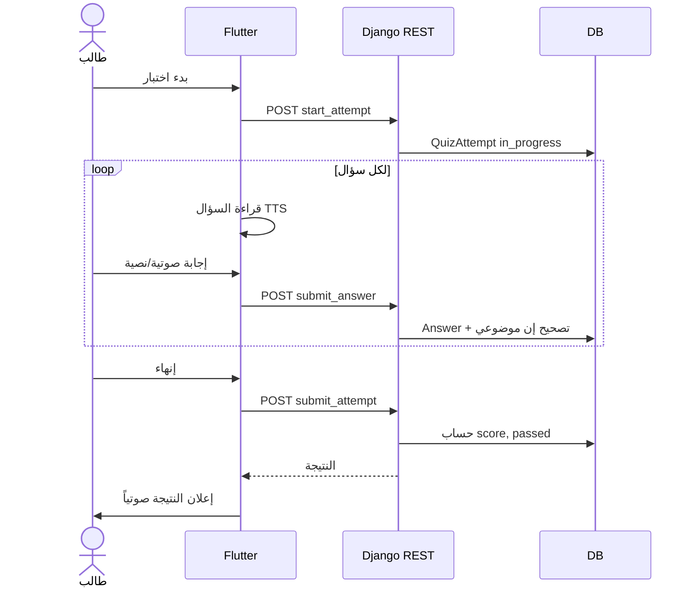


### 15.4 مخطط تسلسل — مراجعة متطوع

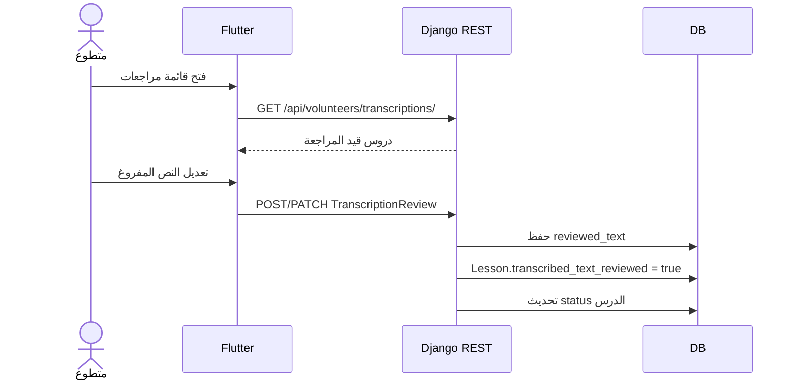


---


## 16. مخططات التدفق والنشاط والسياق


### 16.1 مخطط تدفق البيانات (DFD) — المستوى 0

```mermaid
flowchart LR
    Student([طالب])
    Volunteer([متطوع])
    Admin([مدير])

    System{{نظام بصيرة}}

    Student -->|طلب دروس / إجابات| System
    System -->|صوت / نتائج| Student

    Volunteer -->|مراجعات / تسجيلات| System
    System -->|مهام مراجعة| Volunteer

    Admin -->|إدارة محتوى| System
    System -->|تقارير| Admin

    System --> DB[(قاعدة بيانات)]
    System --> Files[ملفات وسائط]
```


### 16.2 مخطط نشاط — التنقل الصوتي أثناء الدرس

```mermaid
flowchart TD
    Start([بدء الدرس]) --> Play[تشغيل القسم الحالي]
    Play --> Listen{أمر صوتي؟}

    Listen -->|التالي| Next[القسم التالي]
    Listen -->|السابق| Prev[القسم السابق]
    Listen -->|أعد| Play
    Listen -->|توقف| Pause[إيقاف مؤقت]
    Listen -->|استمر| Play
    Listen -->|ابحث عن| Search[بحث في النص]
    Listen -->|لا أمر| Play

    Next --> UpdateProg[تحديث الموضع]
    Prev --> UpdateProg
    UpdateProg --> CheckEnd{آخر قسم؟}
    CheckEnd -->|نعم| Complete[وضع completed=true]
    CheckEnd -->|لا| Play
    Pause --> Listen
    Search --> Play
    Complete --> End([إنهاء])
```


### 16.3 مخطط نشاط — تصحيح الإجابة

```mermaid
flowchart TD
    A[استلام إجابة] --> B{نوع السؤال؟}
    B -->|اختيار متعدد / صح خطأ| C[مقارنة مع is_correct]
    C --> D[حساب points_earned]
    B -->|مفتوح / صوتي| E[needs_review = true]
    E --> F[انتظار متطوع]
    F --> G[مراجعة يدوية]
    G --> D
    D --> H[تحديث مجموع المحاولة]
```


---


## 17. تصميم واجهات البرمجة (API)


### 17.1 هيكل عناوين API


| المجال                   | المسار الأساسي     | الملف |
| ------------------------ | ------------------ | ----- |
| فهرس الواجهات (شجرة الـ API) | `/api/`        | `basera_backend/views.py` |
| المصادقة                 | `/api/auth/`       | `core/urls.py` |
| الدروس والصفوف           | `/api/lessons/`    | `lessons/urls.py` |
| الاختبارات (تطبيق tests) | `/api/tests/`      | `tests/urls.py` |
| المتطوعون                | `/api/volunteers/` | `volunteers/urls.py` |
| الإدارة                  | `/admin/`          | Django Admin |
| واجهة جمعية نبض          | `/nabd/`           | `basera_backend/views.py` |

جميع الواجهات تعيد JSON، وتستخدم مصادقة الرمز `Authorization: Token <key>`. الواجهات القرائية للمحتوى عامة، بينما تتطلب واجهات التقدّم والمحاولات تسجيل الدخول (`IsAuthenticated`).


### 17.2 نقاط النهاية الرئيسية


#### المصادقة (`core`)


| Method | Endpoint              | الوصف              |
| ------ | --------------------- | ------------------ |
| POST   | `/api/auth/register/` | تسجيل حساب         |
| POST   | `/api/auth/login/`    | تسجيل دخول → Token |
| GET    | `/api/auth/profile/`  | الملف الشخصي       |


#### الدروس (`lessons`)


| Method   | Endpoint                                     | الوصف           |
| -------- | -------------------------------------------- | --------------- |
| GET      | `/api/lessons/grades/`                       | الصفوف النشطة   |
| GET      | `/api/lessons/grades/{id}/subjects/`         | مواد صف معيّن   |
| GET      | `/api/lessons/categories/?grade=`            | المواد النشطة   |
| GET      | `/api/lessons/lessons/?category=`            | الدروس المنشورة (فلترة بالمادة) |
| GET      | `/api/lessons/lessons/{id}/`                 | تفاصيل درس + أقسامه |
| GET      | `/api/lessons/lessons/{id}/conversion_status/` | حالة تحويل PDF/صوت |
| POST     | `/api/lessons/lessons/{id}/update_progress/` | تحديث التقدم (يتطلب دخولاً) |
| GET      | `/api/lessons/lessons/{id}/get_progress/`    | قراءة التقدم    |
| GET      | `/api/lessons/lessons/search/?q=`            | بحث نصي         |
| POST     | `/api/lessons/transcribe/`                   | تفريغ ملف صوتي (Whisper محلياً) |
| GET      | `/api/lessons/volunteer-roles/my_roles/`     | أدوار المتطوع الحالي |


#### الاختبارات (`tests`)


| Method | Endpoint                          | الوصف          |
| ------ | --------------------------------- | -------------- |
| GET    | `/api/tests/?category=`           | اختبارات الدروس المنشورة (فلترة بالمادة) |
| GET    | `/api/tests/{id}/`                | تفاصيل الاختبار وأسئلته **بدون** `is_correct` |
| POST   | `/api/tests/{id}/start_attempt/`  | بدء محاولة (يتطلب دخولاً) |
| POST   | `/api/tests/{id}/submit_answer/`  | إرسال إجابة سؤال؛ تصحيح فوري للموضوعية |
| POST   | `/api/tests/{id}/submit_attempt/` | إنهاء المحاولة وحساب `score` و`passed` |
| GET    | `/api/tests/attempts/`            | محاولات المستخدم الحالي مع إجاباتها ونتيجتها |


#### المتطوعون (`volunteers`)


| Method   | Endpoint                                      | الوصف           |
| -------- | --------------------------------------------- | --------------- |
| GET/POST | `/api/volunteers/transcriptions/`             | مراجعات التفريغ |
| POST     | `/api/volunteers/transcriptions/{id}/approve/` | اعتماد مراجعة وتحديث نص الدرس |
| GET/POST | `/api/volunteers/recordings/`                 | تسجيلات صوتية   |
| GET      | `/api/volunteers/recordings/pending_transcription/` | تسجيلات تنتظر التفريغ |


### 17.3 نموذج الاستجابة (مثال درس)

```json
{
  "id": 1,
  "title": "مقدمة في الجبر",
  "category": 3,
  "audio_file": "/media/lessons/audio/lesson1.mp3",
  "transcribed_text": "...",
  "sections": [
    {
      "section_type": "heading",
      "text": "الفصل الأول",
      "order": 0,
      "audio_timestamp": 0.0
    }
  ],
  "status": "published",
  "conversion_status": "completed"
}
```

---


## 18. خريطة الشاشات وتجربة الاستخدام

### 18.1 شجرة التنقّل

```mermaid
flowchart TD
    Login[تسجيل الدخول / إنشاء حساب\nlogin_screen] --> Home[الرئيسية: الصفوف\nhome_screen]
    Home --> Subjects[مواد الصف\ngrade_subjects_screen]
    Subjects --> Lessons[تبويب الدروس\ncategory_lessons_screen]
    Subjects --> Quizzes[تبويب الاختبارات\nquizzes_screen]
    Lessons --> Detail[تفاصيل الدرس\nlesson_detail_screen]
    Detail --> Audio[مشغّل الملف الصوتي]
    Detail --> TTS[قراءة النص TTS]
    Detail --> Voice[أوامر صوتية]
    Quizzes --> Take[حل الاختبار ومراجعة النتيجة\nquiz_take_screen]
    Home --> Settings[إعدادات الصوت\nvoice_settings_screen]
    Home --> Upload[رفع درس - للمشرف\nadmin/upload_lesson_screen]
```

| الشاشة | الملف | الوظيفة الأساسية |
| ------ | ----- | ---------------- |
| الدخول | `login_screen.dart` | تسجيل الدخول أو إنشاء حساب؛ حفظ الرمز محلياً |
| الرئيسية | `home_screen.dart` | قائمة الصفوف النشطة، ترحيب صوتي، الوصول للإعدادات |
| مواد الصف | `grade_subjects_screen.dart` | مواد الصف المختار مع عدد الدروس |
| دروس المادة / الاختبارات | `category_lessons_screen.dart`, `quizzes_screen.dart` | تبويبان: الدروس المنشورة، واختبارات المادة فقط |
| تفاصيل الدرس | `lesson_detail_screen.dart` | مشغّل بشري + TTS، أوامر صوتية، حفظ التقدم |
| حل الاختبار | `quiz_take_screen.dart` | قراءة السؤال صوتياً، اختيار/إجابة، تسليم، إبراز الإجابات الصحيحة بعد التسليم |
| إعدادات الصوت | `voice_settings_screen.dart` | سرعة القراءة، طبقة الصوت، تجربة الصوت |
| رفع درس | `admin/upload_lesson_screen.dart` | رفع محتوى من التطبيق (مكمّل للوحة الإدارة) |

### 18.2 مبادئ واجهة الدرس

1. **أعلى الشاشة:** مشغّل الملف الصوتي (التسجيل البشري) مع شريط تقدّم وإيقاف/متابعة/إيقاف تام.
2. **أسفلها:** وصف الدرس ثم أدوات قراءة النص المفروغ (TTS) مع إيقاف مؤقت ومتابعة وإعادة.
3. **زر عائم:** الميكروفون للأوامر الصوتية.
4. **التعارض ممنوع:** لا تشغيل متزامن للملف وTTS.

### 18.3 اعتبارات TalkBack/VoiceOver

- تسميات واضحة للأزرار (`tooltip` وSemantics).
- أهداف لمس كبيرة عبر `accessible_button` و`accessible_list_tile`.
- إعلانات قصيرة عبر `accessibility_service` عند الأحداث المهمة.
- تجنّب الاعتماد على اللون وحده لإيصال الحالة.

### 18.4 الهوية البصرية المعتمدة في المنتج

اعتمد التطبيق لوحة ألوان ثابتة تعكس اسم **بصيرة** (الإدراك) لا الألوان الافتراضية لمكتبة Material:

| العنصر | القيمة | الدلالة |
| ------ | ------ | ------- |
| الأساسي | `#1B4F72` نيلي | عمق، ثقة، إدراك |
| الثانوي | `#148F77` فيروزي | صوت، حياة، تعلم |
| التأكيد | `#D4A017` ذهبي | نجاح / إجراء مهم |
| الخلفية | `#F4F7FB` | تباين عالٍ مع النص الداكن |

وتُطبَّق الهوية عبر `AppTheme` ومكوّنات مشتركة (`BaseraGradientCard`, `BaseraSurfaceCard`, `BaseraEmptyState`) لضمان اتساق الشاشات وإمكانية الوصول (تباين كافٍ، أزرار ≥ 48px).

---


## 19. البنية البرمجية للمشروع


### 19.1 هيكل المجلدات

```
basera/
├── start.bat                   # لوحة تشغيل موحّدة (باك اند / نبض / فلتر / شجرة API)
├── backend/                    # Django 4.2 + DRF
│   ├── basera_backend/         # الإعدادات، المسارات الجذرية، صفحة /api/ و /nabd/
│   ├── core/                   # User مخصص، تسجيل/دخول بالرمز، اختبارات API (tests.py)
│   ├── lessons/                # صفوف، مواد، دروس، أقسام، تقدّم، أدوار المتطوعين
│   │   ├── models.py
│   │   ├── views.py
│   │   ├── signals.py          # تحويل PDF → نص → صوت آلياً عند حفظ الدرس
│   │   ├── tts_service.py      # gTTS مع بديل pyttsx3
│   │   ├── transcription_service.py   # Whisper (محلي)
│   │   └── text_conversion_service.py # PyPDF2 / pdfplumber
│   ├── tests/                  # الاختبارات الحية: Quiz, Question, Choice, Attempt, Answer
│   ├── volunteers/             # TranscriptionReview, AudioRecording
│   ├── templates/admin/        # قوالب لوحة الإدارة بهوية بصيرة
│   ├── static/admin/           # basera_admin.css / .js / الشعار
│   ├── passenger_wsgi.py       # نقطة دخول الاستضافة (cPanel)
│   ├── pack_for_hosting.ps1    # حزم الخادم للرفع
│   ├── requirements.txt / requirements-hosting.txt
│   └── DEPLOY_NAMECHEAP.md     # دليل النشر
├── nabd-site/                  # واجهة جمعية نبض (HTML/CSS ثابتة تُخدَّم من /nabd/)
├── lib/                        # Flutter (واجهة المستخدم)
│   ├── config/app_config.dart  # عناوين الإنتاج/المحلي والأوامر الصوتية
│   ├── models/                 # user, grade, category, lesson, quiz
│   ├── services/               # api, auth, grade, lesson, quiz, speech, voice_command, accessibility
│   ├── screens/                # 9 شاشات (باب 18.1)
│   ├── theme/app_theme.dart    # هوية بصيرة البصرية
│   └── widgets/                # مكوّنات قابلة للوصول
├── test/widget_test.dart       # اختبارات Flutter
├── tools/                      # أدوات مساعدة (أيقونات، توليد هذه الوثيقة)
├── pubspec.yaml
└── README.md / SETUP.md / DISCUSSION_TEST_REPORT.md
```


### 19.2 تطبيقات Django والمسؤوليات


| التطبيق        | المسؤولية                                             | أبرز الملفات |
| -------------- | ----------------------------------------------------- | ------------ |
| **core**       | User مخصص (`user_type`)، تسجيل ودخول يعيدان Token، الملف الشخصي، مجموعة اختبارات الـ API | `models.py`, `views.py`, `tests.py` |
| **lessons**    | الهرم التعليمي (Grade/Category/Lesson/LessonSection)، تقدّم الطالب، تحويل المحتوى آلياً، VolunteerRole | `models.py`, `views.py`, `signals.py`, `*_service.py`, `admin.py` |
| **tests**      | **الاختبارات الحية** المرتبطة بالدروس، بدء/إجابة/تسليم المحاولة، التصحيح، إخفاء الإجابة الصحيحة | `models.py`, `views.py`, `serializers.py`, `admin.py` |
| **volunteers** | TranscriptionReview مع إجراء `approve`، AudioRecording | `models.py`, `views.py` |
| **basera_backend** | الإعدادات (بيئة/إنتاج)، مسارات الجذر، صفحة `/api/`، خدمة موقع نبض | `settings.py`, `urls.py`, `views.py` |


### 19.3 خدمات الخادم (Backend Services)


| الخدمة                | الملف                        | الوظيفة                 |
| --------------------- | ---------------------------- | ----------------------- |
| TextConversionService | `text_conversion_service.py` | استخراج نص من PDF (PyPDF2 ثم pdfplumber كبديل) |
| TranscriptionService  | `transcription_service.py`   | تفريغ صوت (Whisper) — محلياً فقط |
| TTSService            | `tts_service.py`             | تحويل نص إلى صوت (gTTS مع تقسيم النص وإعادة المحاولة، وبديل pyttsx3 دون اتصال) |
| إشارات الدرس          | `signals.py`                 | `pre_save`/`post_save`: تحديد الوضع (نص/صوت/PDF)، تشغيل السلسلة، تحديث `conversion_status` و`conversion_progress` |

**أوضاع إدخال الدرس الثلاثة (FR-16):**

| الوضع | ما يُدخله المشرف | ما يفعله الخادم | ما يسمعه الطالب |
| ----- | ---------------- | --------------- | --------------- |
| نص مباشر | `text_content` | يعتمد النص، ويولّد صوتاً بـ TTS إن كان مفعّلاً | TTS في التطبيق أو الملف المولَّد |
| ملف صوتي بشري | `audio_file` (+ نص اختياري) | يحفظ الملف؛ يمكن تفريغه محلياً بـ Whisper | التسجيل البشري (المسار المفضّل) |
| PDF | `pdf_file` | استخراج النص ← `text_content` ← توليد صوت ← `completed` | الصوت المولَّد أو TTS للنص |


### 19.4 طبقة Flutter (المخطط)


| الطبقة  | المكونات                                                                                                |
| ------- | ------------------------------------------------------------------------------------------------------- |
| العرض   | login, home, grade_subjects, category_lessons, quizzes, lesson_detail, quiz_take, voice_settings, admin/upload_lesson |
| النماذج | user, grade, category, lesson, quiz (محوّلات JSON آمنة تجاه القيم الفارغة أو النصية) |
| الخدمات | api_service (Dio + Token)، auth_service، grade_service، lesson_service، quiz_service، speech_service (STT/TTS)، voice_command_service، transcription_service، accessibility_service |
| الحالة  | حالة الشاشة (StatefulWidget) مع Riverpod متاحاً للتوسع |
| التخزين | shared_preferences (الرمز، إعدادات الصوت)؛ hive مضاف للعمل دون اتصال مستقبلاً |
| الهوية  | `theme/app_theme.dart` + `widgets/basera_widgets.dart` (بطاقات، حالات فارغة) |
| التهيئة | `config/app_config.dart`: `USE_LOCAL_API` يبدّل بين الخادم المحلي والإنتاج دون تعديل الكود |


### 19.5 الأوامر الصوتية المدعومة


| الأمر      | الإجراء               |
| ---------- | --------------------- |
| التالي     | العنصر/القسم التالي   |
| السابق     | العنصر السابق         |
| أعد        | إعادة التشغيل/القراءة |
| توقف       | إيقاف مؤقت            |
| استمر      | متابعة                |
| الرئيسية   | العودة للرئيسية       |
| الخلف      | رجوع                  |
| ابحث عن... | بحث في المحتوى        |

### 19.6 التشغيل والنشر

**التشغيل المحلي (للعرض أمام اللجنة):** يوفّر ملف `start.bat` في جذر المشروع لوحة تشغيل رسومية بأربعة أزرار، تُنشئ بيئة Python تلقائياً عند الحاجة:

| الزر | ما يحدث |
| ---- | ------- |
| تشغيل الباك اند | تشغيل Django على `127.0.0.1:8000` وفتح الصفحة الرئيسة ولوحة الإدارة |
| فرونت نبض | فتح واجهة الجمعية عبر `/nabd/` (تُخدَّم من الخادم نفسه، دون منفذ منفصل) |
| تطبيق فلتر | `flutter run -d android --dart-define=USE_LOCAL_API=true` على المحاكي/الجهاز |
| شجرة الـ API | فتح `/api/` الذي يعرض فهرس جميع الواجهات |

**النشر على الاستضافة:** تُحزَّم مجلدات الخادم بـ `pack_for_hosting.ps1` (تستثني `venv/` و`db.sqlite3` والملفات الوقتية)، ثم تُرفع إلى cPanel كتطبيق Python نقطة دخوله `passenger_wsgi.py`. تُضبط القيم الحساسة في `.env` على الخادم، وتُخدَّم الملفات الثابتة بـ WhiteNoise، وتُستخدم MySQL كقاعدة إنتاج. يستهلك التطبيق المنشور (APK) عنوان `https://basera.mobishop.online/api` افتراضياً.

```mermaid
flowchart LR
    Dev[تطوير محلي\nSQLite + runserver] -->|pack_for_hosting.ps1| Zip[basera-backend-hosting.zip]
    Zip -->|رفع عبر cPanel| Host[Python App\npassenger_wsgi.py]
    Host --> Env[.env: DEBUG=False\nMySQL, ALLOWED_HOSTS]
    Host --> Live[https://basera.mobishop.online]
    Build[flutter build apk --release] --> APK[basera-release.apk]
    APK -->|AppConfig.productionApiUrl| Live
```


---


## 20. التحكم الصوتي المزدوج في الدرس

يُعد هذا الفصل توثيقاً لفكرة مركزية ظهرت أثناء التنفيذ والاختبار: المستخدم يتعامل مع **صوتين مختلفين** في شاشة واحدة.

### 20.1 المسار الأول — الملف الصوتي البشري

- التقنية: `audioplayers` مع حفظ موضع التشغيل.
- الحالات: تشغيل، إيقاف مؤقت، متابعة من نفس الموضع، إيقاف تام، إعادة من البداية.
- التحدي على الويب: تجنّب `seek(0)` عند المتابعة حتى لا يُلغى موضع المتصفح.

### 20.2 المسار الثاني — القراءة الآلية TTS

- التقنية: `flutter_tts` عبر `SpeechService`.
- الإيقاف المؤقت يستفيد من `pause()` الأصلي للمنصة.
- المتابعة تتم دون `stop()` حتى لا تُفقد الجلسة المتوقفة مؤقتاً.

### 20.3 مخطط الحالة الموحّد

```mermaid
stateDiagram-v2
    [*] --> Idle
    Idle --> PlayingFile: تشغيل ملف
    Idle --> SpeakingTTS: قراءة نص
    PlayingFile --> PausedFile: إيقاف مؤقت
    PausedFile --> PlayingFile: متابعة
    PlayingFile --> Idle: إيقاف تام
    SpeakingTTS --> PausedTTS: إيقاف مؤقت
    PausedTTS --> SpeakingTTS: متابعة
    SpeakingTTS --> Idle: إيقاف
    PlayingFile --> Idle: بدء TTS يوقف الملف
    SpeakingTTS --> Idle: بدء الملف يوقف TTS
```

### 20.4 الأوامر الصوتية المرتبطة بالتشغيل

| الأمر | السلوك المتوقع |
| ----- | --------------- |
| توقف / أوقف | إيقاف مؤقت للمسار النشط |
| استمر / متابعة / استئناف | متابعة من نفس الموضع |
| أعد / كرر | إعادة من البداية |
| اقرأ / قراءة | تشغيل TTS للنص المفروغ |
| تشغيل / ابدأ | تشغيل الملف الصوتي |

---


## 21. التقنيات والأدوات ومبررات الاختيار


### 21.1 جدول التقنيات


| الطبقة       | التقنية                             | الإصدار / الملاحظة         |
| ------------ | ----------------------------------- | -------------------------- |
| Frontend     | Flutter                             | SDK ^3.7.2                 |
| إدارة الحالة | flutter_riverpod                    | ^2.5.1                     |
| STT          | speech_to_text                      | ^7.0.0                     |
| TTS          | flutter_tts                         | 3.8.3                      |
| صوت          | audioplayers, audio_service, record |                            |
| شبكة         | dio, http                           |                            |
| تخزين محلي   | hive, shared_preferences            |                            |
| خطوط وهوية   | google_fonts, flutter_launcher_icons | أيقونة وهوية بصيرة        |
| Backend      | Django                              | 4.2.x (LTS)                |
| API          | Django REST Framework               | ≥3.14 — TokenAuthentication |
| CORS / CSRF  | django-cors-headers, CSRF_TRUSTED_ORIGINS | مضبوطة من `.env`     |
| قاعدة بيانات | SQLite (تطوير) / MySQL (إنتاج)      | PyMySQL؛ التبديل بـ `DB_ENGINE` |
| ملفات ثابتة  | WhiteNoise                          | خدمة CSS/JS الإدارة على الاستضافة |
| تفريغ        | OpenAI Whisper                      | اختياري — محلي فقط         |
| PDF          | PyPDF2, pdfplumber                  |                            |
| TTS خادم     | gTTS (+ pyttsx3 كبديل)              |                            |
| معالجة صوت   | pydub, ffmpeg-python                |                            |
| استضافة      | Namecheap Stellar — cPanel Python App / Passenger | `basera.mobishop.online` |
| تشغيل محلي   | `start.bat` (Batch + PowerShell WinForms) | لوحة بأربعة أزرار    |


### 21.2 مخطط التكامل التقني

```mermaid
flowchart TB
    subgraph Mobile
        STT[speech_to_text]
        TTS[flutter_tts]
        AP[audioplayers]
    end

    subgraph Server
        DJ[Django REST]
        WH[Whisper]
        GT[gTTS]
        PDF[PyPDF2]
    end

    STT -->|أوامر وإجابات| DJ
    DJ --> WH & PDF & GT
    GT -->|ملفات صوت| AP
    DJ -->|JSON + URLs| Mobile
```


---


## 22. إمكانية الوصول والأمان والخصوصية والأخلاقيات


### 22.1 إمكانية الوصول (Accessibility)


| المبدأ          | التطبيق في بصيرة                                    |
| --------------- | --------------------------------------------------- |
| **إدراكي**      | الاعتماد على الصوت بدل الألوان والرسوم              |
| **تشغيلي**      | أزرار كبيرة (accessible_button)، قوائم قابلة للوصول |
| **قارئ الشاشة** | دعم TalkBack و VoiceOver عبر accessibility_service  |
| **تفاعل صوتي**  | voice_command_service للتنقل دون لمس                |


### 22.2 الأمان


| الجانب    | الآلية                                           |
| --------- | ------------------------------------------------ |
| المصادقة  | Token Authentication (DRF)؛ الرمز يُنشأ عند التسجيل والدخول ويُحفظ محلياً في التطبيق |
| الصلاحيات | تمييز `user_type` و`VolunteerRole`؛ `IsAuthenticated` على التقدّم والمحاولات؛ المحاولات مقيّدة بصاحبها |
| نزاهة الاختبار | `ChoicePublicSerializer` يحجب `is_correct` قبل التسليم؛ رفض الإجابات بعد `completed_at` |
| المحتوى   | لا تظهر للطالب إلا الصفوف/المواد النشطة والدروس المنشورة واختباراتها |
| الملفات   | رفع ضمن `MEDIA_ROOT` مع صلاحيات Django؛ مسارات معزولة للصوت وPDF والإجابات |
| الإنتاج   | `SECRET_KEY` و`DEBUG=False` و`ALLOWED_HOSTS` من `.env`؛ HTTPS عبر AutoSSL |
| CORS / CSRF | `CORS_ALLOWED_ORIGINS` و`CSRF_TRUSTED_ORIGINS` من البيئة؛ السماح الكامل في التطوير فقط |


### 22.3 الخصوصية

- بيانات التقدم مرتبطة بالمستخدم ولا تُشارك بين الطلاب.
- ملفات الإجابات الصوتية في مسارات معزولة (`quizzes/audio_answers/`).

---


## 23. خطة الاختبار


### 23.1 أنواع الاختبار


| النوع                   | الهدف                     | أمثلة                         |
| ----------------------- | ------------------------- | ----------------------------- |
| **وحدة (Unit)**         | نماذج Django، حساب الدرجة | QuizAttempt.score             |
| **تكامل (Integration)** | API endpoints             | start_attempt → submit_answer |
| **واجهة (UI)**          | Flutter widgets           | AccessibleButton              |
| **إمكانية وصول**        | TalkBack                  | التنقل في home_screen         |
| **صوت (Manual)**        | STT/TTS عربي              | أوامر "التالي"، قراءة درس     |
| **أداء**                | تحميل قائمة دروس          | < 2 ثانية                     |
| **قبول (UAT)**          | سيناريوهات طالب حقيقي     | استماع درس كامل + اختبار      |


### 23.2 مصفوفة تتبع المتطلبات ↔ الاختبارات


| المتطلب            | حالة الاختبار المقترحة               |
| ------------------ | ------------------------------------ |
| FR-03 تصفح هرمي    | GET grades → categories → lessons    |
| FR-06 تتبع تقدم    | POST update_progress ثم GET          |
| FR-09 تصحيح آلي    | إجابة خاطئة/صحيحة لـ multiple_choice |
| FR-10 مراجعة يدوية | Answer.needs_review بعد open_ended   |
| NFR-01 TalkBack    | فحص يدوي على جهاز Android            |


### 23.3 حالات اختبار نموذجية


| ID    | الخطوات             | النتيجة المتوقعة            |
| ----- | ------------------- | --------------------------- |
| TC-01 | تسجيل طالب جديد     | حساب `user_type=student` + رمز صالح |
| TC-02 | استماع درس 5 دقائق  | `listening_time_seconds` يزيد ويظهر في الإدارة |
| TC-03 | إرسال إجابة بعد التسليم | رفض بحالة 400            |
| TC-04 | متطوع يعتمد تفريغاً | `status=approved` وتحديث نص الدرس |
| TC-05 | طلب تفاصيل اختبار   | الاستجابة لا تحوي `is_correct` |
| TC-06 | تصفح مادة موقوفة    | لا تظهر في `/grades/{id}/subjects/` |

### 23.4 نتائج الاختبارات المنفَّذة (سبتمبر 2026)

نُفِّذت الاختبارات الآلية والتحقق اليدوي على النسخة المسلَّمة، وكانت النتائج كالتالي:

| الطبقة | الأمر | النتيجة |
| ------ | ----- | ------- |
| Django API (`backend/core/tests.py`) | `python manage.py test core --verbosity=2` | **15 / 15 ناجحة** |
| Flutter (`test/widget_test.dart`) | `flutter test` | **5 / 5 ناجحة** |
| تحليل Dart الثابت | `flutter analyze` | **بدون ملاحظات** |
| المحاكي (Pixel 9 Pro، API 36) | `flutter run --dart-define=USE_LOCAL_API=true` | تشغيل، تسجيل، تصفح، استماع، اختبار |
| الخادم المنشور | `GET https://basera.mobishop.online/api/lessons/grades/` | 200 — الصفوف تُحمَّل في APK الإنتاج |

**ما تغطيه اختبارات الـ API الخمسة عشر:** فهرس `/api/`؛ التسجيل يعيد رمزاً؛ الدخول الصحيح/الخاطئ (200/401)؛ إخفاء الصفوف والمواد الموقوفة؛ عرض الدروس المنشورة فقط مع الفلترة بالمادة؛ إخفاء اختبارات الدروس غير المنشورة؛ فلترة الاختبارات بـ `?category=`؛ خلو تفاصيل الاختبار من `is_correct`؛ عدم تفسير `/api/tests/attempts/` كمعرّف اختبار؛ تصحيح الاختيار من متعدد وصح/خطأ بدرجة 100 عند الإجابات الصحيحة؛ رفض الإجابة بعد التسليم؛ اشتراط الدخول لبدء المحاولة.

### 23.5 التعارضات التي كشفها الاختبار وحُلّت قبل التسليم

| # | التعارض | الأثر لو بقي | الإصلاح |
| - | ------- | ------------ | ------- |
| 1 | التسجيل لا يعيد رمز مصادقة | حساب جديد لا يستطيع فتح الاختبارات | إنشاء Token في `RegisterView` وحفظه في `AuthService` |
| 2 | تسريب `is_correct` في تفاصيل الاختبار | الطالب يعرف الإجابة قبل الحل | `ChoicePublicSerializer` + اعتماد نتيجة الخادم في شاشة المراجعة |
| 3 | تبويب اختبارات المادة يعرض كل الاختبارات | اختبار الرياضيات يظهر في العربية | فلتر `?category=` في `QuizViewSet.get_queryset` و`QuizService` |
| 4 | مسار `attempts` يتعارض مع `{id}` | 404 عند طلب المحاولات | ترتيب تسجيل الراوتر في `tests/urls.py` |
| 5 | تصحيح صح/خطأ غير موثوق | إجابات صحيحة تُحسب خاطئة | تطبيع «صح/خطأ/true/false» وإنشاء الخيارين آلياً في الإدارة |
| 6 | المحاكي يرفض المضيف `10.0.2.2` | فشل تحميل الصفوف (400) | إضافة المضيف إلى `ALLOWED_HOSTS` للتطوير |
| 7 | تقدّم الدرس لا يُرسل للخادم | لا يُحفظ الموضع ولا وقت الاستماع | ربط `updateProgress` في `lesson_detail_screen` عند الإيقاف/الإكمال |
| 8 | اختبار الويدجت الافتراضي (Counter) يفشل | جاهزية مناقشة ضعيفة | استبداله باختبارات المحوّلات وشاشة الدخول RTL |
| 9 | سؤال الاختيار من متعدد بلا خيارات في الإدارة | لا يمكن بناء اختبار | Inline للخيارات وإبراز الإجابة الصحيحة بعد التسليم |
| 10 | موقع نبض على منفذ 5500 يفشل وصورة الغلاف مفقودة | واجهة الجمعية لا تعمل في العرض | خدمة الموقع من `/nabd/` عبر Django وتصميم غلاف CSS بلا صورة |

التفاصيل الكاملة في `DISCUSSION_TEST_REPORT.md` ضمن المستودع.


---


## 24. خطة التنفيذ والجدول الزمني


### 24.1 مراحل المشروع (مقترحة لمشروع تخرج)

```mermaid
gantt
    title خطة تنفيذ مشروع بصيرة
    dateFormat  YYYY-MM
    section التحليل
    دراسة المتطلبات والأدبيات     :a1, 2025-09, 1M
    section التصميم
    ERD وUML وAPI                 :a2, after a1, 1M
    section التطوير
    Backend Django                :b1, after a2, 2M
    Flutter واجهات أساسية         :b2, after a2, 2M
    STT/TTS وتكامل صوتي          :b3, after b1, 1M
    نظام اختبارات ومتطوعين       :b4, after b3, 1M
    section الاختبار والتوثيق
    اختبار و UAT                  :c1, after b4, 1M
    إعداد التقرير والعرض          :c2, after c1, 1M
```


### 24.2 توزيع العمل (Roles)


| المرحلة      | Backend  | Frontend | توثيق        |
| ------------ | -------- | -------- | ------------ |
| تحليل وتصميم | مشاركة   | مشاركة   | كامل         |
| محتوى وAPI   | رئيسي    | تكامل    | API docs     |
| صوت وUX      | دعم      | رئيسي    | دليل مستخدم  |
| اختبار       | Unit/API | UI/A11y  | تقرير اختبار |


---


## 25. منهجية التطوير وإدارة المشروع

### 25.1 المنهج

اعتمد المشروع أسلوباً **تكرارياً (Iterative)** قريباً من Agile الخفيف: تحليل أولي، تصميم نماذج، بناء Backend، بناء واجهات Flutter، دمج الصوت، ثم اختبار وتحسين التحكم بالتشغيل.

```mermaid
flowchart LR
    A[تحليل] --> B[تصميم]
    B --> C[تطوير Backend]
    C --> D[تطوير Flutter]
    D --> E[تكامل صوتي]
    E --> F[اختبار وتحسين]
    F --> B
```

### 25.2 أدوات العمل

| المجال | الأداة |
| ------ | ------ |
| إصدار الكود | Git |
| Backend | Django + DRF + SQLite (تطوير) |
| Frontend | Flutter / Dart |
| توثيق | Markdown + Mermaid |
| إدارة محتوى تجريبي | Django Admin |

### 25.3 معايير قبول المسار الأساسي (Definition of Done)

- طالب يسجّل دخولاً ويتصفح حتى درس منشور.
- يستمع ويوقف ويتابع من نفس الموضع.
- يحدّث تقدمه عبر API.
- يبدأ اختباراً ويحصل على نتيجة للأسئلة الموضوعية.
- متطوع يمكنه تسجيل مراجعة تفريغ (وفق الواجهات المتاحة).

---


## 26. القيود والتحديات وإدارة المخاطر


| التحدي                           | التأثير                 | التخفيف                              |
| -------------------------------- | ----------------------- | ------------------------------------ |
| دقة STT للعربية                  | أخطاء في الأوامر        | قوائم أوامر محددة + تأكيد صوتي       |
| جودة TTS                         | تجربة استماع            | السماح بملفات صوتية بشرية            |
| حجم نماذج Whisper                | لا يعمل على الاستضافة المشتركة | التفريغ محلياً ثم رفع النص؛ حالة conversion للتتبع |
| اعتماد gTTS على الإنترنت         | فشل التوليد عند انقطاع الشبكة | تقسيم النص وإعادة المحاولة + بديل pyttsx3 |
| نموذج اختبارات قديم في lessons   | التباس عند إضافة المحتوى | توثيق المسار الحي (tests) في الإدارة والدراسة؛ توحيد لاحق (ملحق أ) |
| بناء مكتبة محتوى                 | وقت طويل                | الاعتماد على المتطوعين + ثلاثة أوضاع إدخال تسرّع الإنتاج |
| Offline غير مكتمل                | استخدام بدون شبكة محدود | Hive + مزامنة لاحقة                  |
| حدود الاستضافة المشتركة          | لا مهام خلفية طويلة     | التحويل عند الحفظ بحجم محدود؛ الترقية إلى VPS عند التوسع |


---


## 27. الأثر التعليمي والاجتماعي المتوقع

### 27.1 على الطالب

- استقلال أكبر في المذاكرة.
- تقليل الاعتماد على وسيط بشري دائم.
- إحساس أوضح بالتقدّم عبر الوقت والاختبارات.

### 27.2 على المتطوع والمؤسسة

- قناة منظمة للمساهمة بدل الجهود المتفرقة.
- إمكانية ربط المحتوى بصفوف ومواد رسمية.
- نواة لشراكات مع جمعيات المكفوفين والمدارس.

### 27.3 على البحث والتخرج

- نموذج تطبيقي لمشكلة Accessibility في السياق العربي.
- وثيقة تصميم قابلة لإعادة الاستخدام في مشاريع لاحقة.
- أساس لبحوث تجريبية (قياس زمن إكمال درس، دقة الأوامر، رضا المستخدم).

```mermaid
flowchart TB
    Product[منصة بصيرة] --> S[أثر على الطالب]
    Product --> V[أثر على المتطوع]
    Product --> I[أثر مؤسسي]
    Product --> R[أثر بحثي]
```

---


## 28. الأعمال المستقبلية

| # | العمل المقترح | الأثر المتوقع | الاعتماد |
| - | ------------- | ------------- | -------- |
| 1 | واجهة متطوع داخل التطبيق (قائمة مراجعات، اعتماد، رفع تسجيل) بدل الاعتماد على لوحة الإدارة | يوسّع المشاركة المجتمعية | واجهات `volunteers` موجودة |
| 2 | عمل كامل دون إنترنت: تنزيل الدروس وتخزينها في Hive مع مزامنة التقدّم | تعلم في مناطق ضعيفة الاتصال | hive مضاف في `pubspec` |
| 3 | تفريغ Whisper على خادم مخصص أو خدمة سحابية | تفريغ آلي للتسجيلات على الإنتاج | ترقية الاستضافة |
| 4 | تلخيص ذكي للدرس في حقل `summary` | مراجعة سريعة قبل الاختبار | نموذج لغوي |
| 5 | لوحة إحصاءات للمشرف (وقت الاستماع، نسب النجاح) | متابعة تربوية | بيانات LessonProgress وQuizAttempt |
| 6 | إشعارات (درس جديد، نتيجة مراجعة) | ارتباط مستمر | FCM |
| 7 | توحيد نموذجي الاختبارات في تطبيق واحد | تبسيط الصيانة | ملحق أ |
| 8 | نشر iOS ونسخة ويب على النطاق نفسه | اتساع الوصول | حساب مطوّر Apple |
| 9 | دراسة تجريبية مع مستخدمين مكفوفين (زمن إكمال درس، دقة الأوامر، الرضا) | تحقّق علمي من الفرضيات | شراكة مع جمعية نبض |

---

## 29. الخلاصة والتوصيات للمشرف

### 29.1 الخلاصة

مشروع **بصيرة** ليس مجرد تطبيق يقرأ النص بصوت مرتفع؛ إنه محاولة لإعادة تعريف تجربة التعلّم الرقمي للمكفوفين في السياق العربي: محتوى هرمي يعكس المدرسة والجامعة، تفاعل صوتي كامل، تقييم عادل، ومجتمع متطوعين يحرس الجودة.

من الناحية **الإنسانية**، ينحاز المشروع إلى الاستقلالية والكرامة. ومن الناحية **الهندسية**، يقدّم بنية Client–Server، نماذج بيانات قابلة للتوسع، مخططات تحليل وتصميم متكاملة، ونموذجاً أولياً قابلاً للتشغيل.

قيمة بصيرة تُقاس بقدرة طالبٍ على إكمال **درس واختبار** بصوته ويده، دون أن يشعر أن التقنية صُممت لغيره. بهذا يجمع المشروع بين هندسة البرمجيات وفلسفة الإتاحة في منتج واحد قابل للنقاش الأكاديمي.

### 29.2 التوصيات للمشرف — نقاط متابعة مقترحة

| # | التوصية | الغرض |
| - | ------- | ----- |
| 1 | اعتماد **نطاق محتوى تجريبي** (صف واحد، 2–3 مواد، 5–10 دروس) | تجنب تضخم المشروع |
| 2 | جدولة **UAT** مع مستخدم من الفئة المستهدفة إن أمكن | تقويم Audio-first |
| 3 | مناقشة **تبرير الاحتفاظ بنموذج الاختبارات القديم** وخارطة توحيده | نضج هندسي |
| 4 | مراجعة **شاشة الدرس** (باب 20) في العرض الحي | إثبات الإيقاف/المتابعة وحفظ التقدّم |
| 5 | ربط كل مخطط UML/ERD **بملف في الكود** (مصفوفة 8.3) | اتساق التحليل والتنفيذ |
| 6 | إعداد **15 شريحة** (ملحق ز) + demo 3–5 دقائق عبر `start.bat` | جاهزية المناقشة |
| 7 | إعادة تشغيل الاختبارات الآلية (باب 23.4) قبل يوم المناقشة | ضمان عدم الانحدار |

### 29.3 ما يُتوقع من الطالب عند التسليم

1. هذه الوثيقة (النسخة 4.0) بصيغتَي Word وPDF.
2. تطبيق قابل للتشغيل (APK) + خادم منشور على `basera.mobishop.online`.
3. محتوى تجريبي في لوحة الإدارة: صف نشط ← مادة ← درس منشور ← اختبار بأسئلة.
4. تقرير الاختبار `DISCUSSION_TEST_REPORT.md`.
5. عرض تقديمي وفيديو demo.

---

## 30. قاموس المصطلحات

| المصطلح | التعريف الموجز |
| ------- | --------------- |
| Audio-first | منهج تصميم يجعل الصوت القناة الأساسية لإنجاز المهام |
| STT | Speech-to-Text: تحويل الكلام إلى نص |
| TTS | Text-to-Speech: قراءة النص صوتياً |
| TalkBack | قارئ شاشة Android |
| VoiceOver | قارئ شاشة iOS |
| Grade | الصف الدراسي في هرم المحتوى |
| Category | المادة الدراسية المرتبطة بصف |
| Lesson | وحدة الدرس التعليمية |
| LessonSection | فقرة/عنوان/نقطة داخل الدرس |
| LessonProgress | تتبع موضع ووقت استماع الطالب |
| Quiz / Question | الاختبار وأسئلته |
| QuizAttempt | محاولة طالب لاختبار |
| VolunteerRole | دور المتطوع وصلاحياته |
| TranscriptionReview | مراجعة بشرية للتفريغ النصي |
| conversion_status | حالة تحويل PDF/نص إلى صوت |
| Token Authentication | مصادقة عبر رمز يُرسل مع طلبات API |
| Mermaid | لغة نصية لرسم المخططات داخل Markdown |
| ERD | مخطط الكيانات والعلاقات |
| UML | لغة النمذجة الموحّدة |
| DFD | مخطط تدفق البيانات |
| UAT | اختبار قبول المستخدم |
| Offline | العمل دون اتصال بالإنترنت |
| Flutter | إطار لبناء تطبيقات جوال متعددة المنصات |
| Django REST Framework | بناء واجهات API فوق Django |

---

## 31. المراجع

1. World Wide Web Consortium (W3C). *Web Content Accessibility Guidelines (WCAG) 2.1.*
2. Django Software Foundation. *Django Documentation 4.2.* https://docs.djangoproject.com/
3. Django REST Framework. *API Guide.* https://www.django-rest-framework.org/
4. Google Flutter Team. *Flutter Documentation.* https://docs.flutter.dev/
5. OpenAI. *Whisper: Robust Speech Recognition.*
6. وثائق المشروع الداخلية: `README.md`, `PROJECT_DOCUMENTATION.md`, `PROJECT_STRUCTURE.md`, `SETUP.md`
7. معايير إمكانية الوصول لنظامي Android (TalkBack) و iOS (VoiceOver) — وثائق المطورين الرسمية.
8. مبادئ تصميم تجربة المستخدم للمحتوى الصوتي والتنقّل غير البصري — أدبيات HCI ذات الصلة.

---

## 32. الملاحق

### الملحق أ — ملاحظة ازدواجية نموذج الاختبارات

يوجد في المشروع نموذجان باسم `Quiz`:

| | `tests.Quiz` (المسار الحي) | `lessons.Quiz` (نموذج موسّع غير مفعّل) |
| - | -------------------------- | --------------------------------------- |
| الارتباط | بالدرس مباشرة (`lesson`) | بالمادة مع درس اختياري |
| الحقول | title, description, passing_score | + quiz_type, duration_minutes, max_attempts, status, is_active |
| الأسئلة | 4 أنواع، `question_audio`، `points` | 4 أنواع + `correct_answer` نصي |
| المحاولة | score, passed, started/completed | + percentage, time_taken_minutes, needs_review |
| الواجهات | `/api/tests/` — يستخدمها التطبيق | لا واجهات؛ ظاهر في الإدارة فقط |
| الاختبارات الآلية | مغطّى بـ `core/tests.py` | غير مغطّى |

**القرار في هذه النسخة:** اعتماد `tests.Quiz` مرجعاً وحيداً للدراسة والتطبيق ولوحة الإدارة، لأنه الأبسط والمكتمل والمختبَر، وارتباطه بالدرس يضمن ألا يظهر اختبار لدرس غير منشور. يُحتفظ بـ `lessons.Quiz` كتصميم مرجعي لميزات مستقبلية (مدة الاختبار، حد المحاولات) على أن يُنقل ما يلزم منها إلى `tests` ثم يُحذف، في خطوة refactor موثّقة (باب 28، البند 7).

### الملحق ب — حالات الدرس وحالات التحويل

**Lesson.status:** draft → review → approved → published

**conversion_status:** idle → extracting_text → text_extracted → converting_audio → completed / failed

### الملحق ج — أنواع المستخدمين والأدوار

| user_type | الوصف |
| --------- | ----- |
| student | طالب |
| volunteer | متطوع |
| admin | مدير |

| VolunteerRole.role | الوصف |
| ------------------ | ----- |
| reviewer | مراجع محتوى |
| transcriber | مفروغ صوتي |
| quiz_reviewer | مراجع اختبارات |
| content_creator | منشئ محتوى |
| admin | مدير متطوعين |

### الملحق د — أسئلة شائعة في مناقشة التخرج

1. **لماذا Flutter؟** كود واحد لـ Android و iOS ودعم قوي للوصول.
2. **لماذا Django؟** سرعة تطوير وAdmin جاهز وORM قوي.
3. **كيف تُضمن جودة التفريغ؟** مراجعة متطوع + TranscriptionReview.
4. **ماذا لو فشل التعرف الصوتي؟** أوامر محددة + أزرار لمس كبيرة.
5. **كيف يُحسب النجاح؟** percentage ≥ passing_score.
6. **الفرق عن قارئ الشاشة؟** تصميم صوتي أولاً لا طبقة فوق واجهة بصرية.
7. **لماذا مساران للصوت؟** التسجيل البشري أوضح غالباً؛ TTS يغطي غياب الملف والمراجعة النصية.
8. **ما أهم مخاطر الإطلاق؟** شح المحتوى ودقة STT العربي وتكلفة التخزين.

### الملحق هـ — قائمة المخرجات للتسليم الأكاديمي

| # | المخرج |
| - | ------ |
| 1 | هذا الكتاب التعريفي / دراسة مشروع التخرج (Word + PDF) |
| 2 | التطبيق القابل للتشغيل (`basera-release.apk` / محاكي / Chrome) |
| 3 | الخادم الخلفي المنشور + قاعدة بيانات تجريبية + حزمة `basera-backend-hosting.zip` |
| 4 | ملف التشغيل الموحّد `start.bat` للعرض الحي |
| 5 | تقرير الاختبار `DISCUSSION_TEST_REPORT.md` |
| 6 | عرض تقديمي مستخرج من الأبواب 1–15 |
| 7 | فيديو demo (3–5 دقائق) لسيناريو طالب ومتطوع |
| 8 | أدلة التثبيت والنشر `SETUP.md`, `backend/DEPLOY_NAMECHEAP.md` |

### الملحق و — خريطة سريعة للأفكار الكبرى في المشروع

```mermaid
mindmap
  root((بصيرة))
    الفكرة
      إنصاف تعليمي
      صوت أولاً
    المحتوى
      صف
      مادة
      درس
      أقسام
    التفاعل
      ملف بشري
      TTS
      أوامر صوتية
    التقييم
      اختبارات
      تصحيح آلي
      مراجعة بشرية
    المجتمع
      متطوعون
      أدوار
      جودة
    التقنية
      Flutter
      Django
      API
```

### الملحق ز — مقترح هيكل العرض التقديمي (15 شريحة)

1. العنوان والفريق
2. المشكلة بالأرقام/القصص
3. الفئة المستهدفة
4. الرؤية والرسالة
5. الحل في صورة واحدة
6. مقارنة سريعة بالبدائل
7. رحلة المستخدم
8. البنية المعمارية
9. ERD مبسّط
10. شاشة الدرس والتحكم الصوتي
11. الاختبارات والمتطوعون
12. التقنيات
13. التحديات والحلول
14. الأعمال المستقبلية
15. الخاتمة والعرض الحي

---

*أُعدّت هذه الوثيقة بناءً على تحليل الكود المصدري والوثائق الفعلية لمشروع بصيرة (Basera)، ورُوجعت في النسخة 4.0 لتطابق النسخة المنشورة على الاستضافة ونتائج الاختبارات النهائية. تُولَّد نسخة Word/PDF آلياً من هذا المصدر عبر `tools/md_to_docx.py` مع تصيير المخططات أشكالاً مرقّمة.*

**إصدار الوثيقة:** 4.0 — نسخة التسليم  
**تاريخ المراجعة:** سبتمبر 2026
